# JAMC DAVAO CONNECT

## SYSTEM WORKFLOW GUIDE

*People. Groups. Care. Growth.*

| | |
| --- | --- |
| **Prepared for** | JAMC-Davao |
| **Document version** | 1.0 |
| **Date** | October 15, 2026 |
| **Audience** | Administrators, church leadership, and whoever maintains the system |
| **Companion document** | [User Manual](JAMC-Davao-Connect-User-Manual.md) (step-by-step instructions with screenshots) |

This guide describes the end-to-end flows of JAMC Davao Connect as they are implemented. For each important flow it separates:

- **User flow** — what a person does on screen.
- **System flow** — what the system does behind it.

Diagrams use Mermaid, which GitHub and most Markdown viewers draw as pictures.

---

## Contents

1. [Architecture in brief](#1-architecture-in-brief)
2. [Security model](#2-security-model)
3. [Authentication](#3-authentication)
4. [Self-registration and account approval](#4-self-registration-and-account-approval)
5. [Members and user accounts](#5-members-and-user-accounts)
6. [Visitor to member](#6-visitor-to-member)
7. [Attendance](#7-attendance)
8. [Absentee follow-up](#8-absentee-follow-up)
9. [Cell groups](#9-cell-groups)
10. [Follow-ups and pastoral care](#10-follow-ups-and-pastoral-care)
11. [Discipleship](#11-discipleship)
12. [Giving](#12-giving)
13. [Expenses](#13-expenses)
14. [Account transfers and balances](#14-account-transfers-and-balances)
15. [Reports](#15-reports)
16. [Notifications](#16-notifications)
17. [Activity log](#17-activity-log)
18. [Appearance settings](#18-appearance-settings)

---

## 1. Architecture in brief

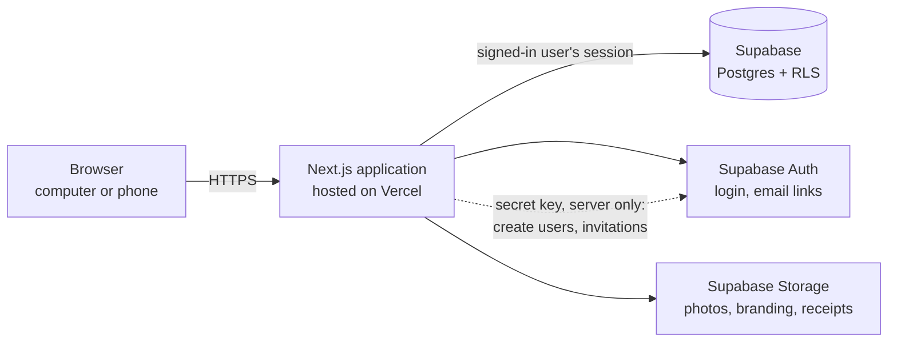

- **Application:** Next.js (React) on Vercel. Pages are rendered on the server; data is read and written through Server Actions.
- **Data:** Supabase Postgres. Every table has row level security (RLS). Schema changes are numbered SQL migrations in `supabase/migrations/`.
- **Files:** Supabase Storage buckets — `people-photos` (private), `payment-proofs` (private), `branding` (public: logos and backgrounds).
- **Email:** Supabase Auth sends sign-up confirmations, invitations and password resets; links point to the live site (`lib/site-url.ts`).

---

## 2. Security model

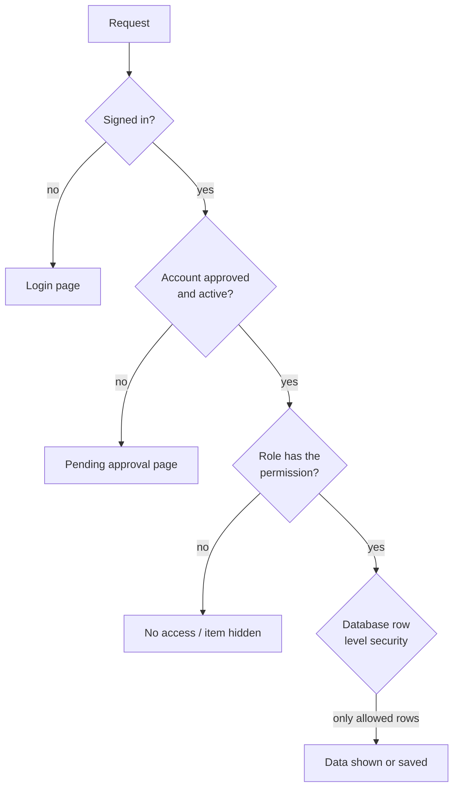

1. **Authentication** — Supabase Auth session.
2. **Approval** — `profiles.approval_status = approved` and the account is active. Pending, rejected and suspended accounts are routed to `/pending-approval` and RLS returns no data to them.
3. **Permission** — roles grant permissions (`role_permissions`); `has_permission()` checks them.
4. **Row level security** — the database decides which rows each person may read or change. Hiding a button is never the protection.

Privileged multi-step operations are database functions that check the permission themselves: approving registrations, linking members to accounts, posting and voiding giving collections, archiving a member together with their account.

---

## 3. Authentication

**User flow**

```
Login page → email + password → Sign In → home page
Forgot password → email → link → new password → signed in
```

**System flow**

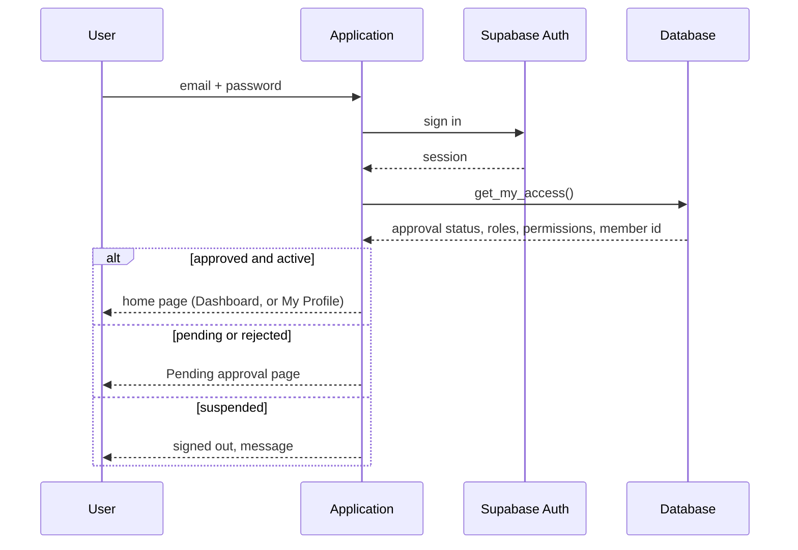

Email links (confirmation, invitation, reset) open `/auth/confirm`, which exchanges the link's token for a session and continues to the right page. A link opened on a different device from the one used to sign up still confirms the email; the person is asked to sign in.

---

## 4. Self-registration and account approval

**User flow (applicant)**

```
Sign up form → confirm email → Pending approval page → (approved) sign in
```

**User flow (administrator)**

```
Notification / Account Approvals → Review → check possible matches → choose role + member record → Approve (or Reject)
```

**System flow**

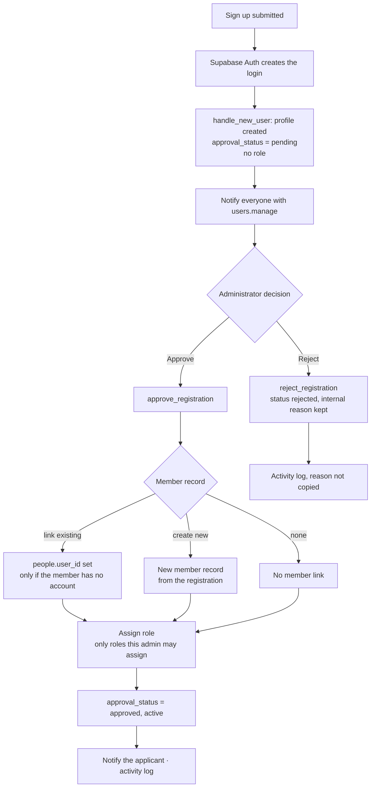

Rules enforced in the database:

- A new self-registration is always **pending**, whatever the browser sends.
- Only a Super Admin may assign Super Admin, or roles carrying administration, finance or confidential-care permissions they do not hold.
- Members are never matched by name automatically; possible matches (same email, mobile number or name) are only suggestions.
- Accounts created by an administrator are approved in the same step.

---

## 5. Members and user accounts

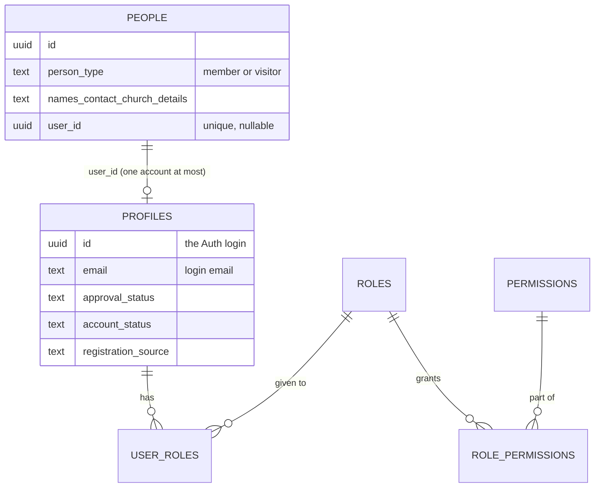

- **Member** (`people`) is the person. **User account** (`profiles` + Supabase Auth) is the login.
- `people.user_id` is **unique**: one member, at most one account; one account, at most one member.
- Only current members (not visitors or archived records) can be linked.
- The account's display name follows the member record. The **login email** (Auth) is separate from the member's **contact email**.

**Creating an account for an existing member — system flow**

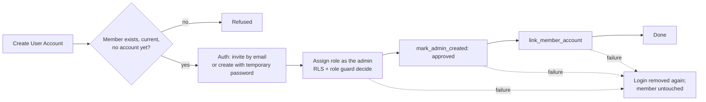

**Archiving a member who has an active account:** `archive_member_and_disable_account` disables the account (never deletes it) and archives the member in one step. Archiving such a member without disabling the account is refused.

---

## 6. Visitor to member

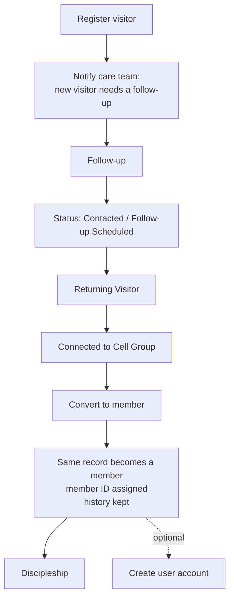

`convert_visitor_to_member` changes the record in place: attendance, follow-ups, prayer request and first-visit details stay attached. A member cannot be changed back into a visitor.

---

## 7. Attendance

**User flow**

```
Attendance → Services → New session (or open one) → mark each person → Mark remaining as Absent → Save
```

**System flow**

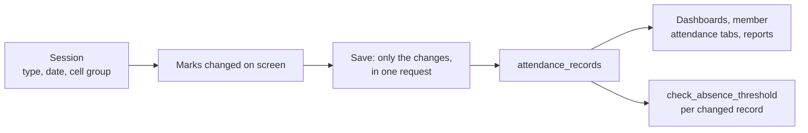

- Statuses decide what counts as present (Present and Late do; Absent and Excused do not).
- Cell leaders record attendance only for the groups they lead.

---

## 8. Absentee follow-up

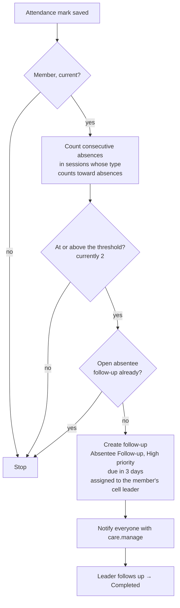

The threshold and the types that count are set under Settings → Attendance.

---

## 9. Cell groups

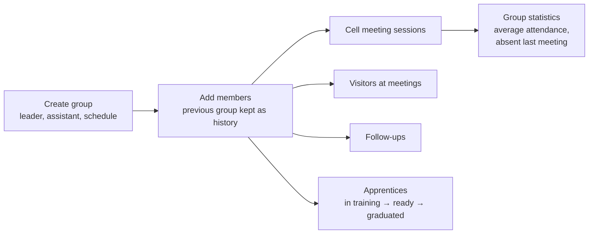

A member belongs to one group at a time (`cell_group_members` with a `left_at` date for history). Leaders see and update only their own groups.

---

## 10. Follow-ups and pastoral care

**Follow-ups**

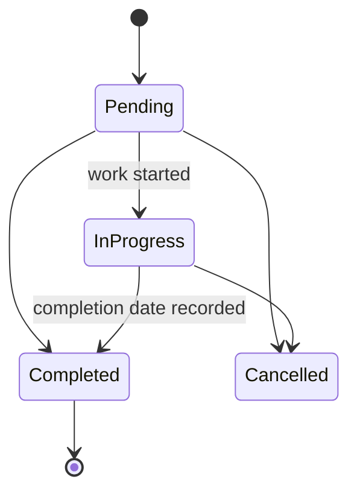

Sources: created by hand, from a new visitor, or automatically for absences. The assignee is notified on assignment and when it is due or overdue.

**Pastoral care visibility**

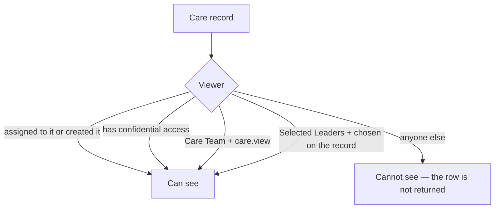

The *Pastoral Care Summary* report shows counts by type only.

---

## 11. Discipleship

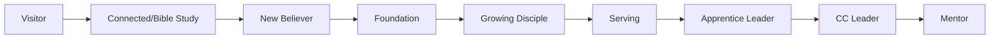

**System flow:** `set_discipleship` records the new stage and mentor and closes the previous stage as history (never overwritten); milestones are separate dated records; the member and mentor are notified of a new stage. Stage names are configurable (Settings → Discipleship).

---

## 12. Giving

### 12.1 Three separate descriptions

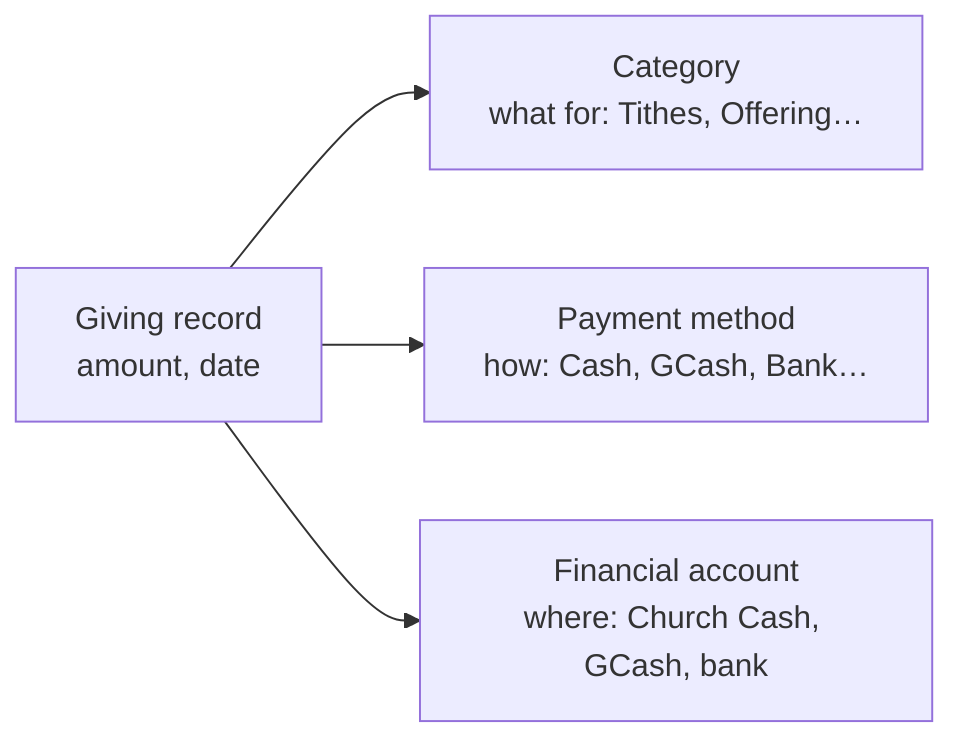

### 12.2 Single gift

```
User:   Finance → Giving → Add giving → fields → Save
System: validate → insert giving_records (as the signed-in user, RLS) → dashboards, balances, reports
```

### 12.3 Giving collection (batch entry)

**User flow**

```
Finance → Giving → New collection → service + date → Summary or Detailed → enter amounts → Save as draft / Review → Confirm & post
```

**System flow**

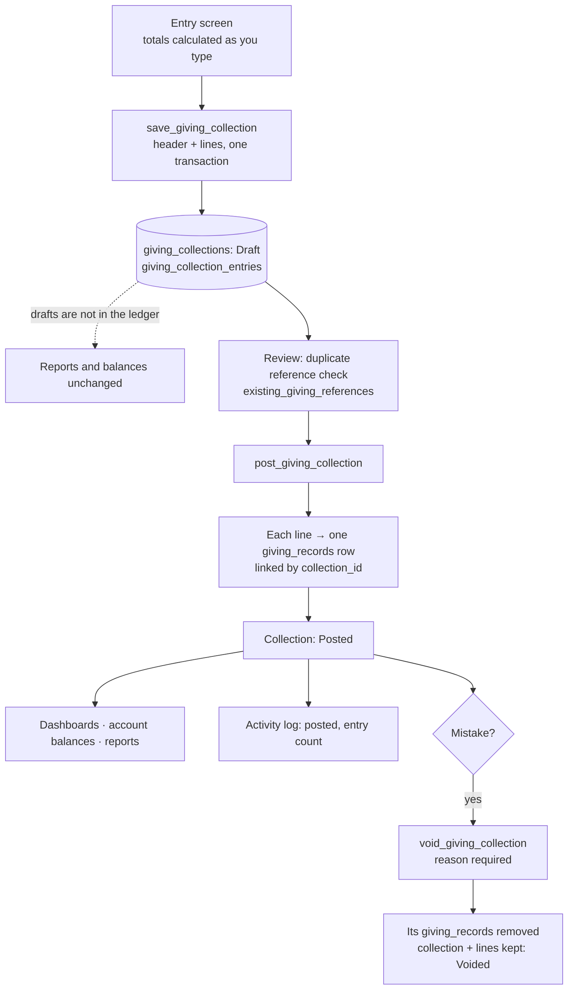

**No double counting.** The collection header has no amount of its own; its total is the sum of its lines. Only `giving_records` is counted by reports and balances, and a posted line appears there exactly once. Records that came from a collection cannot be edited or deleted one by one (a database guard); the collection is voided instead.

**Summary vs detailed**

| | Summary | Detailed / individual |
| --- | --- | --- |
| Entry | One amount per category × payment method | One row per gift |
| Donor | Not recorded | Optional (when individual giving is tracked); empty = anonymous |
| Reference numbers | Not asked | Required on posting for methods that need them |
| Records created on posting | One per non-empty cell | One per row |

---

## 13. Expenses

```
User:   Finance → Expenses → Add expense → category, description, amount, payee, method, paid-from account, reference → Save
System: validate → expenses row (RLS) → balance of the paid-from account goes down → finance dashboard and reports
```

---

## 14. Account transfers and balances

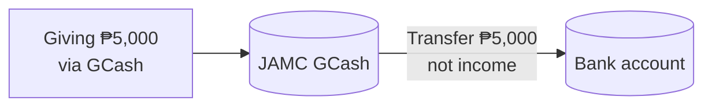

| | GCash | Bank | Total giving |
| --- | ---: | ---: | ---: |
| After giving | +5,000 | 0 | 5,000 |
| After transfer | 0 | +5,000 | **5,000** (unchanged) |

**Account balance** = opening balance + giving received into it − expenses paid from it + transfers in − transfers out (`account_statement`). Account numbers are masked for anyone without `finance.manage` (`financial_account_directory`).

---

## 15. Reports

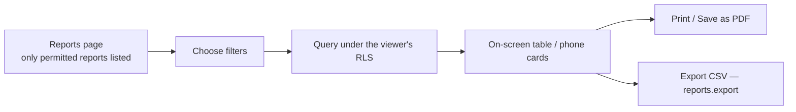

Available: Membership, Visitor, Attendance, Cell Group, Follow-up, Pastoral Care Summary (counts only), Discipleship, Ministry, Event, Church Growth, Finance, Account Transaction.

---

## 16. Notifications

| Notification | Created when | Sent to |
| --- | --- | --- |
| New account registration | Someone signs up | users.manage |
| Your account was approved | Registration approved | The applicant |
| New visitor needs a follow-up | Visitor registered | care.manage |
| *Name* reached the absence threshold | Absentee follow-up created | care.manage |
| A follow-up was assigned to you | Follow-up assigned | Assignee |
| Follow-up due today / overdue | On sign-in, for due follow-ups | Assignee |
| Birthday today | On sign-in, on the birthday | People who can see that member |
| Event today / tomorrow | On sign-in | People who can see events |
| Discipleship milestone / new stage | Stage changed | Mentor / member |

Time-based notifications (due, birthday, event) are produced when a person opens the system, not by a background scheduler. Each notification is created only once (de-duplicated).

---

## 17. Activity log

Recorded automatically by the database: creating, updating, archiving and deleting records; account approvals, rejections and links; giving collections created, posted, voided and discarded; settings and appearance changes (including separate entries for typography, login content, motion and background). Finance amounts and confidential care notes are deliberately **not** written into the log.

---

## 18. Appearance settings

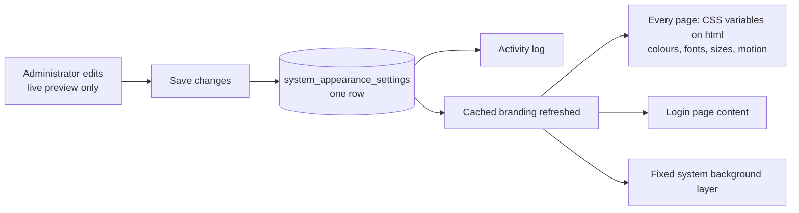

All appearance settings (branding, login content, colours, typography, motion, background) live in one row and reach every page, including the login page, as CSS variables. The system background is a fixed layer behind the application: page content scrolls over it and it never moves.
