# JAMC DAVAO CONNECT

## SYSTEM USER MANUAL & WORKFLOW GUIDE

*People. Groups. Care. Growth.*

| | |
| --- | --- |
| **Prepared for** | JAMC-Davao |
| **System** | JAMC Davao Connect — Church Tracker |
| **Web address** | https://jamc-davao-connect.vercel.app |
| **Document version** | 1.0 |
| **Date** | October 15, 2026 |
| **Companion document** | [System Workflow Guide](JAMC-Davao-Connect-System-Workflow.md) |

> [!NOTE]
> Every screenshot in this manual is taken from the running JAMC Davao Connect system (`npm run docs:screenshots`), using the system's demo records. Email addresses and mobile numbers are replaced with placeholders such as `name@example.com` before each picture is taken. Red numbered circles (①, ②, …) are added only to the picture to point at the items explained below it.

---

## Table of Contents

1. [Introduction](#1-introduction)
2. [System Overview](#2-system-overview)
3. [Roles and Access](#3-roles-and-access)
4. [Getting Started: Signing In](#4-getting-started-signing-in)
5. [Registering (Sign Up) and Account Approval](#5-registering-sign-up-and-account-approval)
6. [Dashboard](#6-dashboard)
7. [Search and Quick Actions (Command Palette)](#7-search-and-quick-actions-command-palette)
8. [Notifications](#8-notifications)
9. [My Profile](#9-my-profile)
10. [Members](#10-members)
11. [Members and User Accounts](#11-members-and-user-accounts)
12. [Visitors](#12-visitors)
13. [Attendance](#13-attendance)
14. [Cell Groups](#14-cell-groups)
15. [Follow-ups](#15-follow-ups)
16. [Pastoral Care](#16-pastoral-care)
17. [Discipleship](#17-discipleship)
18. [Ministries](#18-ministries)
19. [Events](#19-events)
20. [Finance](#20-finance)
21. [Reports](#21-reports)
22. [Administration](#22-administration)
23. [Settings](#23-settings)
24. [Mobile Guide](#24-mobile-guide)
25. [Common Workflows at a Glance](#25-common-workflows-at-a-glance)
26. [Troubleshooting](#26-troubleshooting)
27. [Security Notes](#27-security-notes)
28. [Glossary](#28-glossary)

---

## 1. Introduction

**JAMC Davao Connect** is JAMC-Davao's church management system. It keeps the church's records in one secure place, so pastors, cell leaders, the finance team and administrators work from the same, up-to-date information.

It helps the church manage:

- **People**: members and visitors, with birthdays
- **Attendance**: Sunday services, prayer meetings, cell meetings and events
- **Cell Groups**: leaders, members, meetings, visitors and apprentices
- **Care**: follow-ups and confidential pastoral care
- **Growth**: discipleship stages, ministries and events
- **Finance**: giving, expenses, church accounts and transfers
- **Reports**: printable and downloadable summaries
- **Administration**: user accounts, approvals, roles, activity logs and settings

The system works in any modern web browser, on a computer, tablet or phone. Nothing needs to be installed. On a phone it behaves like an app, with tabs at the bottom of the screen.

> [!IMPORTANT]
> What each person can see and do depends on their **role**. If a menu item in this manual does not appear for you, your role does not include it. See [Roles and Access](#3-roles-and-access).

---

## 2. System Overview

The menu on the left (or the **More** tab on a phone) is grouped as follows. Each item appears only for people whose role allows it.

| Group | Menu item | What it is for |
| --- | --- | --- |
| — | **Dashboard** | Church-wide numbers, charts and lists |
| People | **Members** | Church member records |
| | **Visitors** | First-time and returning guests |
| | **Birthdays** | Upcoming member birthdays |
| Attendance | **Services** | Attendance sessions (services, meetings, events) |
| | **Attendance Records** | Every attendance mark, searchable |
| | **Attendance History** | Sessions grouped by date |
| Groups | **Cell Groups** | Cell groups and their members |
| Care | **Follow-ups** | Calls, visits and other follow-ups |
| | **Pastoral Care** | Confidential care records |
| Growth | **Discipleship** | Each member's growth stage and mentor |
| | **Ministries** | Ministries and who serves in them |
| | **Events** | Church events and their attendance |
| Finance & Reports | **Finance** | Giving, expenses, accounts and transfers |
| | **Reports** | Printable and downloadable reports |
| Administration | **Users** | Login accounts |
| | **Account Approvals** | Self-registrations waiting for review |
| | **Roles & Permissions** | What each role may do |
| | **Activity Logs** | Who changed what, and when |
| | **Settings** | Church details, appearance and lists |


**Figure 1. Main navigation.** The sidebar groups the modules. ① Dashboard ② Members ③ Services (attendance) ④ Cell Groups ⑤ Follow-ups ⑥ Finance ⑦ Users.

At the top of every page:

- **Page title and breadcrumb** show where you are.
- **Search** (or **Ctrl + K**) opens the [Command Palette](#7-search-and-quick-actions-command-palette).
- **Bell** shows your [notifications](#8-notifications).
- **Theme button** switches Light, Dark or System mode (if the administrator allows it).
- **Your avatar** opens your profile, password change and sign out. If your account is linked to a member record with a photo, your photo is shown.

---

## 3. Roles and Access

A **role** is a named set of **permissions**. Each permission allows one kind of action, such as "View all members" or "Record giving". A person can have more than one role; they then have every permission of every role they hold.

The table below is the **current configuration** of JAMC Davao Connect, read from the system on October 15, 2026. A Super Admin can change it under **Administration → Roles & Permissions**.

### 3.1 The roles

| Role | Purpose (as described in the system) |
| --- | --- |
| **Super Admin** | Complete access to the whole system. |
| **Pastor** | Church-wide access to people, attendance, groups, care and reports. |
| **Cell Leader** | Access limited to the cell groups they lead. |
| **Member** | Limited portal: own profile, group and activities. |
| **Finance** | Created for finance staff. *Currently has no permissions assigned.* |
| **Ministry Head** | Created for ministry heads. *Currently has no permissions assigned.* |

> [!IMPORTANT]
> The **Finance** and **Ministry Head** roles currently have no permissions, so someone holding only that role sees almost nothing. A Super Admin should tick the needed permissions under **Roles & Permissions** (for example *View giving and expenses* and *Record giving and expenses* for Finance) before giving these roles to anyone.

### 3.2 Access matrix

✓ = allowed · **Own groups** = only the cell groups the person leads (or mentors, for discipleship) · — = not allowed

| Area | Super Admin | Pastor | Cell Leader | Member |
| --- | :---: | :---: | :---: | :---: |
| Dashboard | ✓ | ✓ | ✓ (own groups) | — (opens My Profile) |
| Members — view | ✓ all | ✓ all | Own groups | Own record only |
| Members — add, edit, archive | ✓ | ✓ | — | — |
| Visitors — view | ✓ | ✓ | ✓ | — |
| Visitors — register, edit | ✓ | ✓ | — | — |
| Attendance — view | ✓ all | ✓ all | Own groups | Own attendance |
| Attendance — record | ✓ | ✓ | Own groups | — |
| Cell Groups | ✓ manage all | ✓ manage all | Update own groups | — |
| Follow-ups | ✓ | ✓ | ✓ (and own groups) | — |
| Pastoral Care | ✓ incl. confidential | ✓ (not *Pastor Only*) | ✓ (not *Pastor Only*) | — |
| Discipleship | ✓ | ✓ | Own groups / mentees | — |
| Ministries | ✓ | ✓ | ✓ | — |
| Events | ✓ | ✓ | ✓ | View only |
| Finance | ✓ | — | — | — |
| Reports | ✓ view and export | ✓ view and export | — | — |
| Users and Account Approvals | ✓ | — | — | — |
| Roles & Permissions | ✓ | — | — | — |
| Activity Logs | ✓ | — | — | — |
| Settings | ✓ | — | — | — |

> [!NOTE]
> A pastoral care record is always visible to the person it is **assigned to** and the person who **created** it, whatever their role. See [Pastoral Care](#16-pastoral-care).

### 3.3 Approval, role and permission are three different things

| | Question it answers | Where it is managed |
| --- | --- | --- |
| **Account approval** | May this person sign in at all? | Administration → Account Approvals |
| **Role** | Which group of permissions do they have? | Administration → Users, or the member's Account Access |
| **Permission** | Exactly what may that role do? | Administration → Roles & Permissions |

An approved account with no role can sign in but sees almost nothing. A role gives nothing to an account that is not approved.

---

## 4. Getting Started: Signing In


**Figure 2. Login page.** The left side shows the church branding, welcome message and Bible verse (set by the administrator). The right side is the sign-in form.

1. **Email Address** — the email your account was created with.
2. **Password** — select the eye icon to show or hide what you typed.
3. **Remember my email** — keeps your email filled in next time on this device.
4. **Sign In** — opens your home page.
5. **Forgot password?** — sends a password reset link to your email.
6. **Create an account** — opens the registration form (see [section 5](#5-registering-sign-up-and-account-approval)).

**Expected result:** you arrive at the Dashboard (or at **My Profile** if your role has no dashboard).

### 4.1 Forgot password

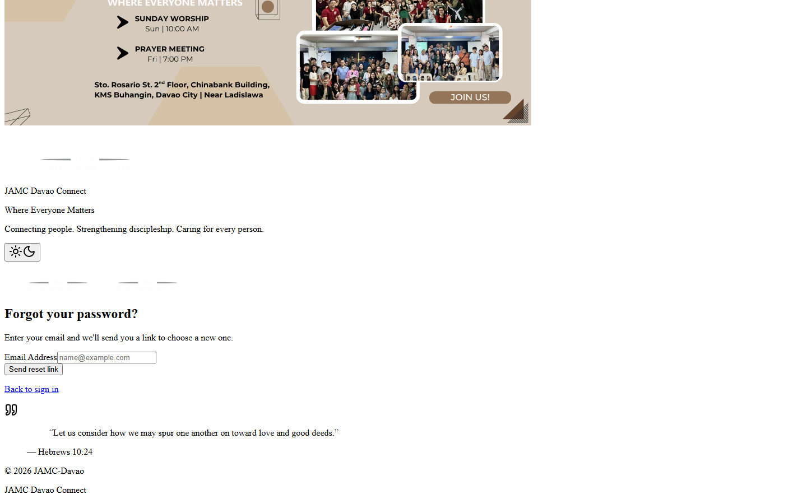

**Figure 3. Forgot password.**

1. On the login page select **Forgot password?**
2. Enter your email address and send.
3. Open the email and select the link. It is valid for a limited time.
4. Choose a new password and save.

**Expected result:** you are signed in with the new password.

> [!NOTE]
> For security, the system shows the same message whether or not the email has an account.

### 4.2 Changing your password

Signed in, open your avatar → **Profile** → **Change password**.

---

## 5. Registering (Sign Up) and Account Approval

People can register themselves. A registration does **not** give access straight away: an administrator reviews it first.

```
Sign Up → Confirm email → Pending approval → Admin reviews → Member record linked → Role assigned → Approved → Can use the system
```

### 5.1 How to register

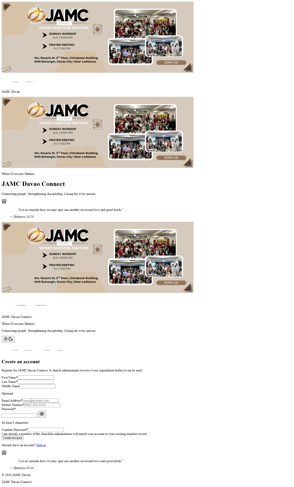

**Figure 4. Sign up.**

1. On the login page select **Create an account**.
2. Enter **First Name**, **Last Name**, optional **Middle Name**, **Email Address** and **Mobile Number**.
3. Choose a **Password** (at least 8 characters) and type it again in **Confirm Password**.
4. If you already belong to the church, tick **I am already a member of the church** and, under **Help us find your record**, write something that helps the administrator find you (for example your cell group or your leader's name). Only administrators see this.
5. Select **Create Account**.
6. Open the confirmation email and select **Confirm email address**.

**Expected result:** a "Registration Submitted" page. When you sign in before approval, you see a **Pending approval** page instead of the system.

> [!IMPORTANT]
> Registering does not give access to members, finance, care or any other data. Access starts only when an administrator approves the account and gives it a role.

If a registration is not approved, the person sees only that it was not approved; the administrator's internal reason is never shown to them.

### 5.2 Reviewing registrations (administrators)

Administrators are notified of each new registration, and the **Account Approvals** menu item shows how many are waiting. The Dashboard also shows a *Pending account approvals* card.

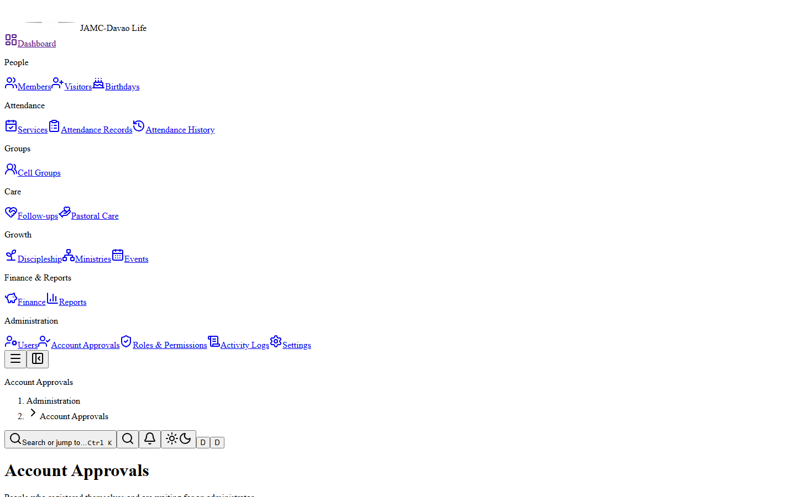

**Figure 5. Account Approvals.** Pending registrations with name, email, mobile number, date and the applicant's own note about their member record.

**How to approve a registration**

1. Open **Administration → Account Approvals**.
2. Find the person (use **Search**; the **Status** filter shows *Pending approval*, *Not approved* or *Approved*).
3. Select **Review**. The dialog shows what the person entered and **Possible member matches**: existing members with the same email, mobile number or name.
4. Choose the **Role**. You can only choose roles you are allowed to assign; only a Super Admin can give Super Admin, finance or administration access.
5. Choose the **Member record**:
   - **Link possible match: …** — this login belongs to that existing member.
   - **Link to another existing member** — then search for and choose the member.
   - **Create a new member record** — for someone not yet in the church records.
   - **Approve without a member record** — for an account that should not be tied to a member.
6. Select **Approve Account**.

**Expected result:** the person can sign in with the chosen role, and receives a notification that the account was approved.

> [!IMPORTANT]
> The system never links an account to a member by name automatically. Always check that a suggested match is really the same person.

**How to reject a registration:** select **Reject**, optionally write an internal reason, and confirm.

---

## 6. Dashboard

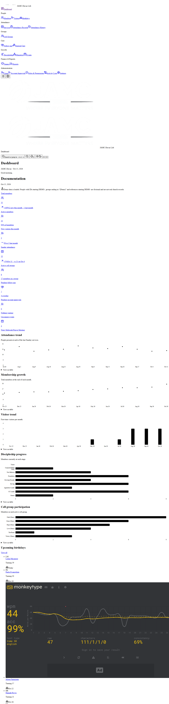

**Figure 6. Dashboard.** Numbers, charts and lists for the whole church, or for your own cell groups if you are a cell leader.

**Cards (top row)** — select a card to open the related page.

| Card | Meaning |
| --- | --- |
| Total members | Members on record, with the change in new members compared with last month |
| Active members | Members marked active, and their share of all members |
| New visitors this month | First-time visitors this month, compared with last month |
| Sunday attendance | People present at the latest recorded Sunday service |
| Active cell groups | Active groups, and how many members are in a group |
| Pending follow-ups | Open follow-ups, and how many are overdue |
| Pending account approvals | Registrations waiting (administrators only) |
| Upcoming events | Events ahead, and the next one |

**Charts** — each has **View as table** under it.

- **Attendance trend** — people present at each of the last Sunday services.
- **Membership growth** — total members at the end of each month.
- **Visitor trend** — first-time visitors per month.
- **Discipleship progress** — members at each stage.
- **Cell group participation** — members in each active group.

**Lists** — Upcoming birthdays, Recent visitors, Pending follow-ups and Upcoming events, each with **View all**. Long lists scroll inside their card.

---

## 7. Search and Quick Actions (Command Palette)

Press **Ctrl + K** (Windows) or **⌘ + K** (Mac), or select the search box at the top (the magnifying glass on a phone).


**Figure 7. Command palette.**

- **Go to any page** you have access to, by typing part of its name.
- **Search records**: people, cell groups, ministries, events and attendance sessions.
- **Quick actions**: Add Member, Add Visitor, Record Attendance, Create Cell Group, Create Follow-up, Add Care Record, Add Event, Record Giving, Record Expense, Record Transfer, My Profile. Each appears only if your role allows it.

Use the arrow keys and **Enter** to open a result, **Esc** to close.

---

## 8. Notifications

The bell at the top shows a count of unread notifications. Select it to read them; each one links to the related page.


**Figure 8. Notifications.**

| Notification | Who receives it |
| --- | --- |
| New account registration | People who manage users |
| Your account was approved | The person who registered |
| A follow-up was assigned to you | The person assigned |
| Follow-up due today / Follow-up overdue | The person assigned |
| New visitor needs a follow-up | People who manage care |
| *Name* reached the absence threshold | People who manage care |
| Birthday today | People who can see the member |
| Event today / Event tomorrow | People who can see events |
| Discipleship milestone / You reached a new discipleship stage | The mentor / the member |

---

## 9. My Profile

Open your avatar → **Profile**.

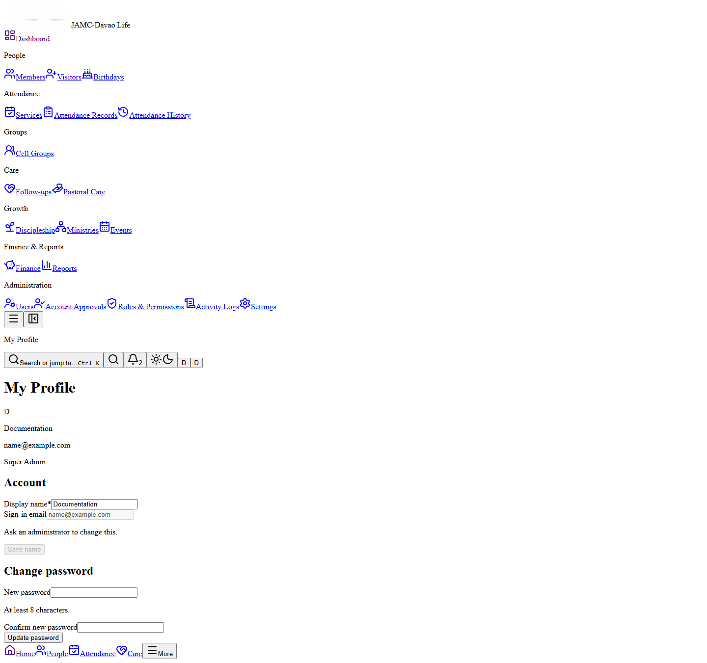

**Figure 9. My Profile.**

- **My church record** — your member details (when your account is linked to a member).
- **My contact details** — update your nickname, contact number, email and address yourself.
- **Account** — your name and login email.
- **Change password**.
- **My attendance** — your own attendance summary.

---

## 10. Members

### 10.1 Member list

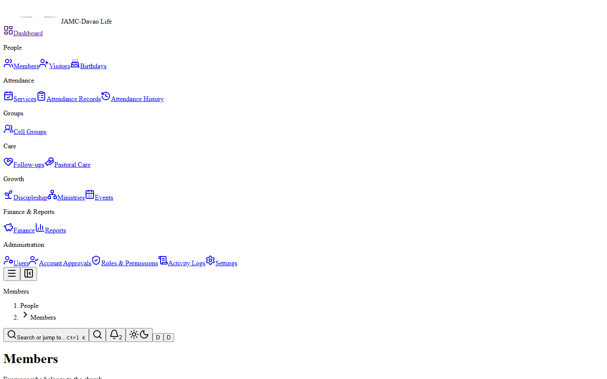

**Figure 10. Members.**

1. **Add member** — opens the new member form.
2. **Search** — by name, member ID, contact number or email.
3. **Filters** — status (active, inactive, archived), gender, cell group, ministry, membership status and discipleship stage.

Select a column heading to sort. Select a name to open the profile. On a phone each member is shown as a card.

### 10.2 Adding a member

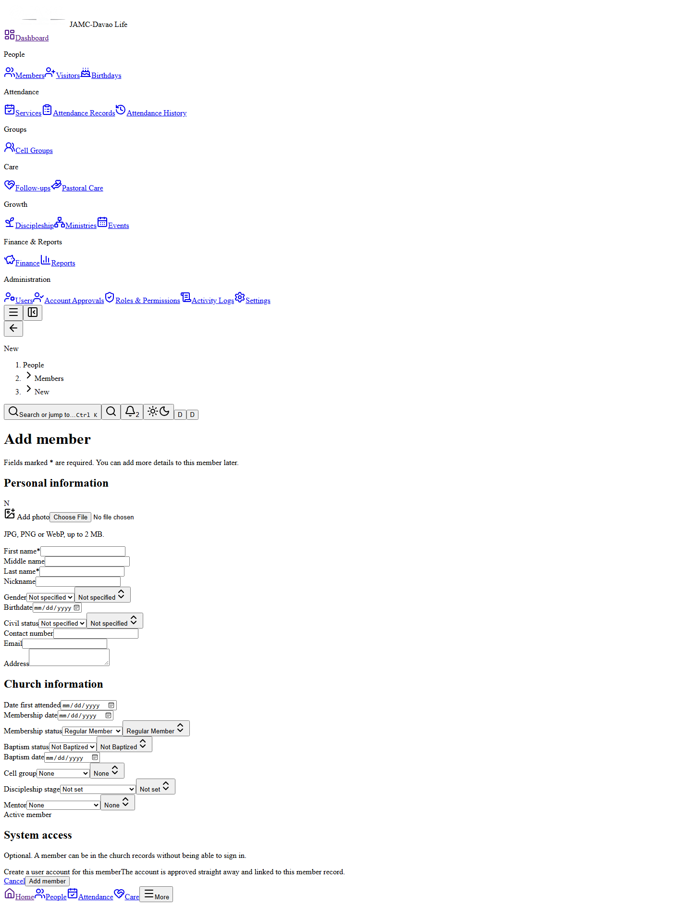

**Figure 11. Add member form.**

**How to add a member**

1. Open **People → Members** and select **Add member**.
2. **Personal information**: optional photo (JPG, PNG or WebP, up to 2 MB), **First name** and **Last name** (required), middle name, nickname, gender, birthdate, civil status, contact number, email and address.
3. **Church information**: date first attended, membership date, membership status, baptism status and date, cell group, discipleship stage, mentor, and **Active member**.
4. **System access** (shown only to people who manage users): tick **Create a user account for this member** if the person needs to sign in, then enter the login email, role and how they get their password. Leave it unticked for members who do not need to sign in.
5. Select **Add member**.

**Expected result:** the profile of the new member opens and the member appears in the list with an automatically assigned member ID.

> [!IMPORTANT]
> A **member** is the person's church record. A **user account** is a login. Most members never need a login. Creating a member does not let that person sign in unless a user account is also created.

If the member is saved but the account cannot be created (for example the email is already used), the member is kept and the profile opens with the **Create User Account** form, so it can be retried without creating the member twice.

### 10.3 Member profile

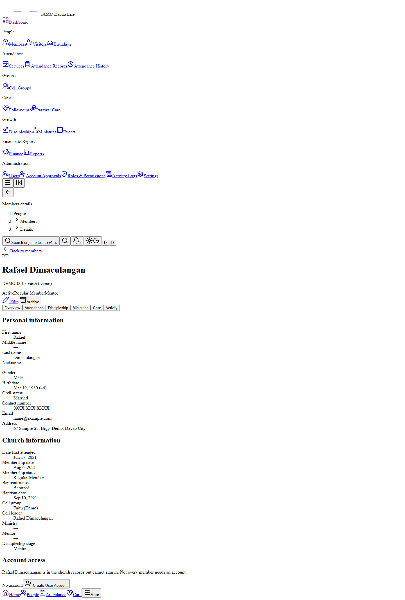

**Figure 12. Member profile.** The header shows photo, name, member ID, cell group and status. **Edit** and **Archive** are at the top right.

Tabs:

| Tab | Contents |
| --- | --- |
| **Overview** | Personal information, church information, **Account access** (administrators), and first visit details if the person started as a visitor |
| **Attendance** | Attendance rate, totals, consecutive absences, monthly chart and recent history |
| **Discipleship** | Current stage and mentor, with a link to the full discipleship profile |
| **Ministries** | Ministries the member serves in |
| **Care** | Follow-ups for this person, and a link to their pastoral care history (only records you may see) |
| **Activity** | Changes made to this record (people with log access) |

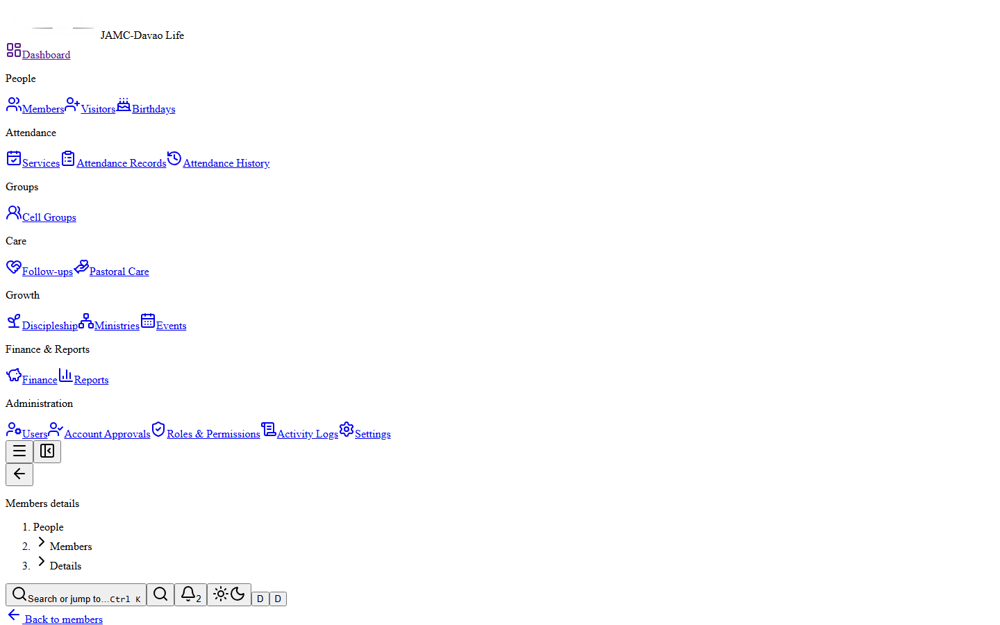

**Figure 13. Member attendance tab.**

### 10.4 Editing and archiving

- **Edit** opens the same form as Add member.
- **Archive** hides the member from lists and counts; their history is kept and they can be restored. If the member has an active user account, the system offers **Archive Member and Disable Account**: the account is disabled (not deleted) at the same time.

### 10.5 Birthdays

**People → Birthdays** lists upcoming member birthdays.

---

## 11. Members and User Accounts

```
MEMBER (the person)  →  optional USER ACCOUNT (login)  →  ROLE  →  PERMISSIONS
```

- A member may exist **without** an account.
- A member can have **at most one** account. The system refuses a second one.
- Name and contact details live on the member record; the account holds only the login email, role and status.

### 11.1 Account Access on a member profile

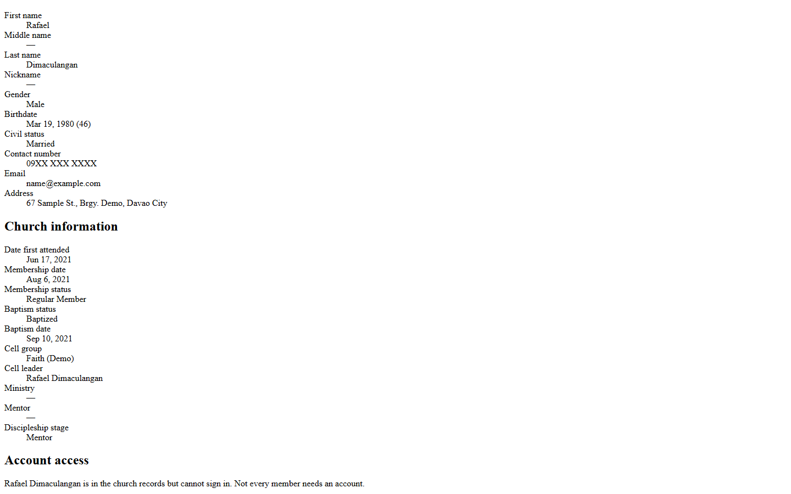

**Figure 14. Account access** (Overview tab, visible to people who manage users).

**Without an account:** *No account* and **Create User Account**.

**How to create an account for an existing member**

1. Open the member's profile, **Overview** tab, **Account access**.
2. Select **Create User Account**.
3. Check the **Login email** (filled in from the member's email; change it if they sign in with another one).
4. Choose the **Role**.
5. Choose **Send an invitation email** (they choose their own password) or **I set a temporary password**.
6. Select **Create account**.

**Expected result:** the account is approved straight away and linked to this member. No second member record is created.

**With an account**, Account access shows the status, login email, role, last login, and these actions:

| Action | What it does |
| --- | --- |
| Change Role | Changes the account's roles |
| Change Login Email | Changes the email they sign in with (the member's contact email stays as it is) |
| Send Password Reset / Resend Invitation | Emails a link to set a password |
| Suspend Account / Reactivate Account | Stops or restores sign-in; the member record and history are untouched |
| View Account | Opens the account in Administration → Users |

### 11.2 Add User (Administration)

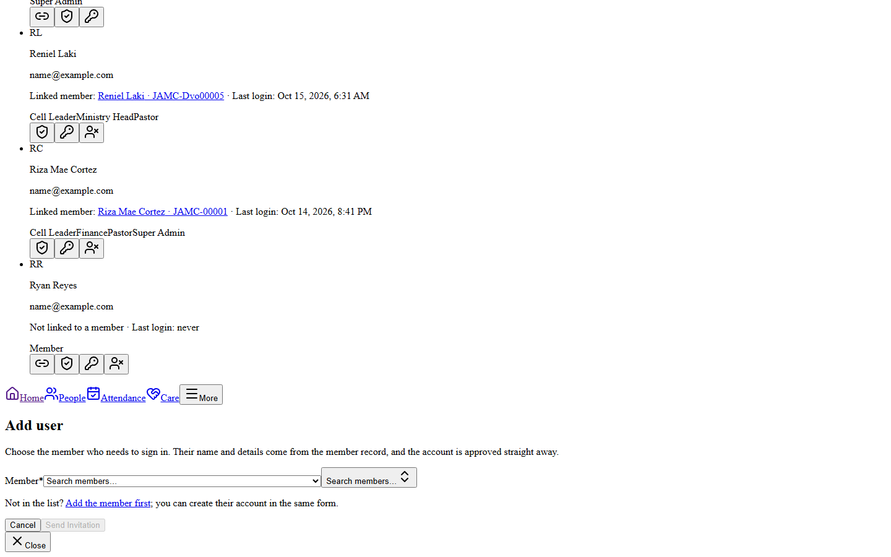

**Figure 15. Add user.** The person is chosen from existing members.

1. Open **Administration → Users** and select **Add user**.
2. **Member** — search and choose the member. Members who already have an account are marked *has an account*; choosing one shows their existing account instead of creating another.
3. Check the **Login email**.
4. Choose the **Role** and **How they get their password**.
5. Select **Send Invitation** or **Create Account**.

If the person is not in the list, add them as a member first (they can get their account in the same form).

---

## 12. Visitors

### 12.1 Visitor list

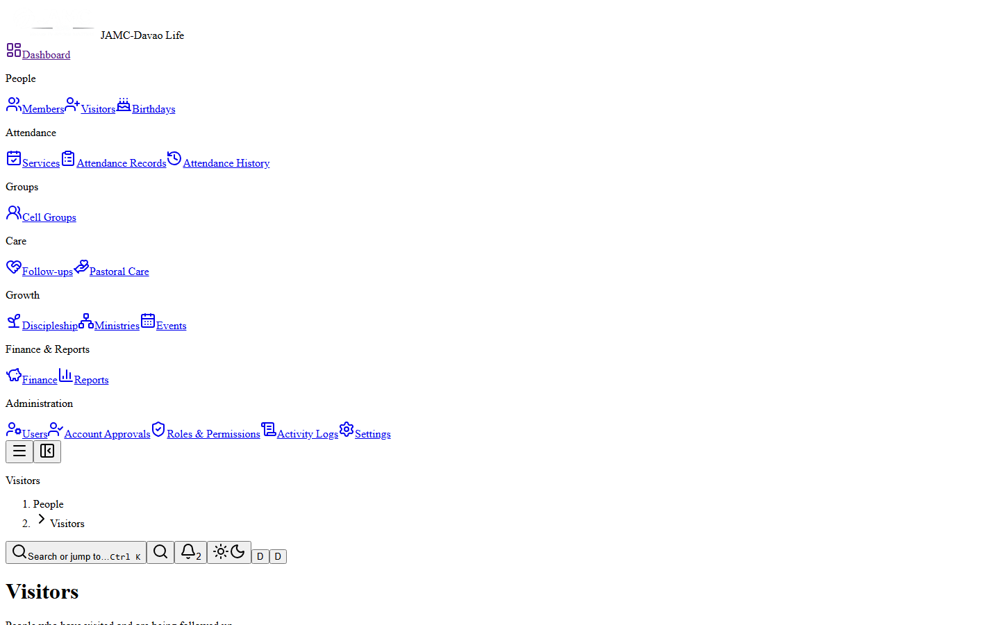

**Figure 16. Visitors.** Search, filters and the follow-up status of each visitor.

Visitor statuses: **New**, **Contacted**, **Follow-up Scheduled**, **Returning Visitor**, **Connected to Cell Group**, **Became Member**.

### 12.2 Registering a visitor

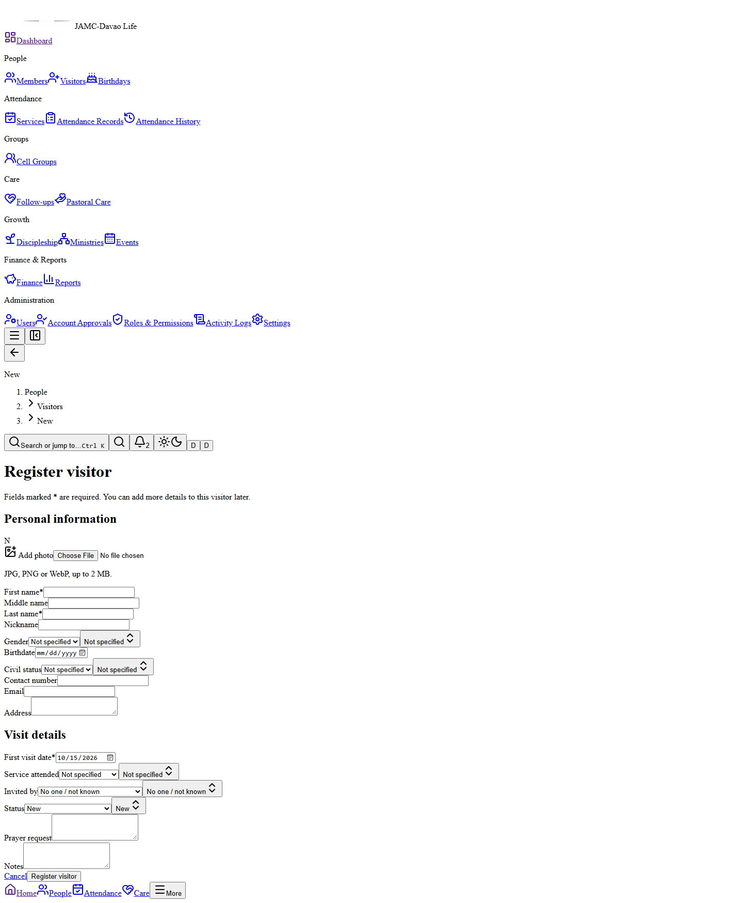

**Figure 17. Register visitor.**

1. Open **People → Visitors** and select **Register visitor**.
2. Enter the personal information (first and last name required).
3. Under **Visit details**: **First visit date** (required), **Service attended**, **Invited by** (choose a member from the list, or *Someone else (not a member)* and type the name), **Status**, **Prayer request** and **Notes**.
4. Save.

**Expected result:** the visitor appears in the list, and people who manage care are notified that a new visitor needs a follow-up.

### 12.3 Visitor profile and converting to a member

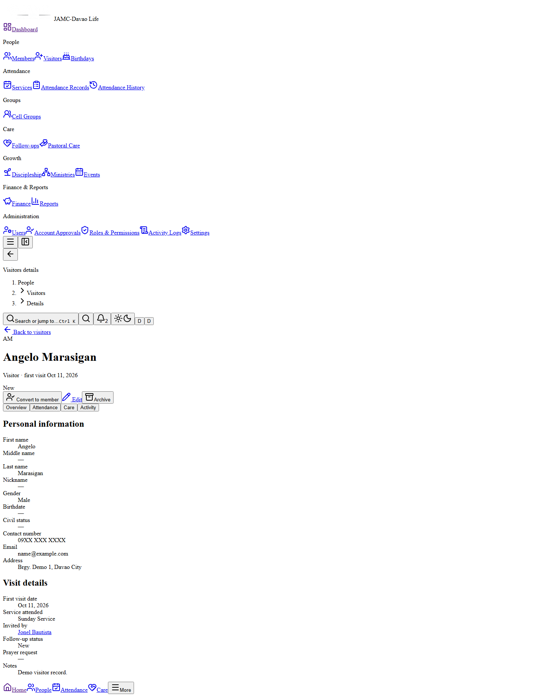

**Figure 18. Visitor profile.**

**How to convert a visitor to a member**

1. Open the visitor's profile.
2. Select **Convert to member** and confirm.

**Expected result:** the same record becomes a member. Their details, attendance, follow-ups and visit history stay with them. A user account can then be created from the member profile if needed.

---

## 13. Attendance

Attendance is recorded per **session**: one service, meeting or event on one date.

Attendance types in use: **Sunday Service**, **Prayer Meeting**, **Caring Circle**, **Special Event**, **Other**.
Attendance statuses: **Present** and **Late** (both count as present), **Absent**, **Excused**.

### 13.1 Sessions

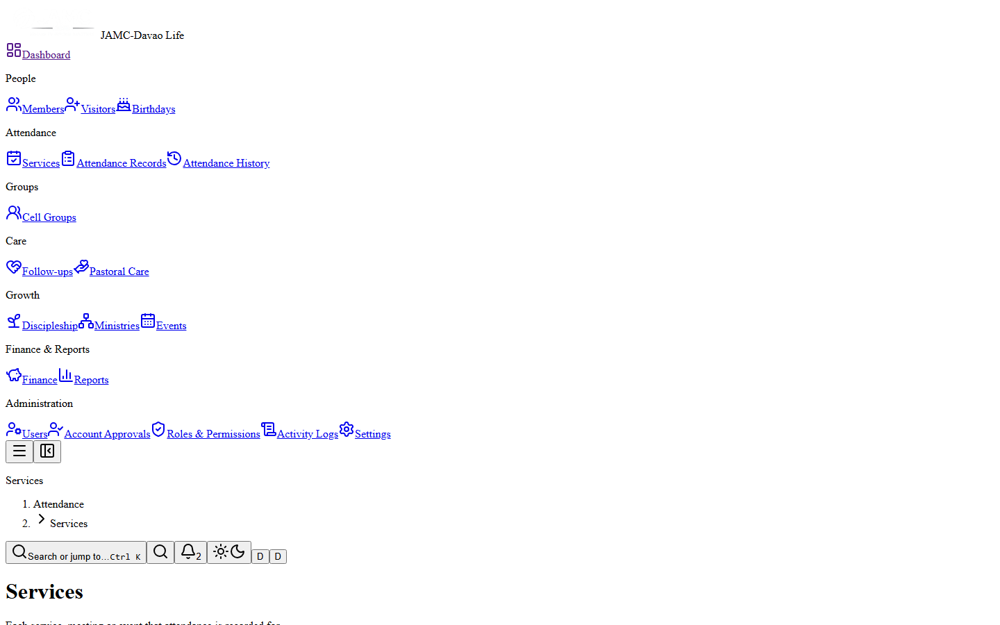

**Figure 19. Services (attendance sessions).**

**How to start a session**

1. Open **Attendance → Services** and select **New session**.
2. Enter the **Name** (e.g. *Sunday Service*), **Service / event type**, **Date**, the **Cell group** for a cell meeting, and optional **Notes**.
3. Save.


**Figure 20. New session.**

### 13.2 Marking attendance

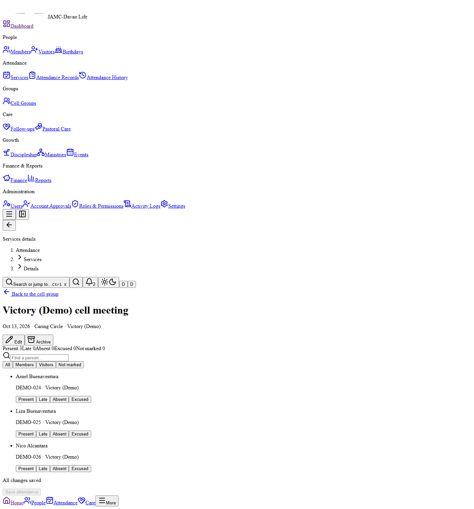

**Figure 21. Record attendance.**

1. Open the session.
2. Use **Find a person** and the filters (**All**, **Members**, **Visitors**, **Not marked**).
3. Tap a status (Present, Late, Absent, Excused) beside each person.
4. When everyone present is marked, **Mark remaining … as Absent** completes the list.
5. Select **Save**. The counter shows unsaved changes; **Undo** discards them.

**Expected result:** "Attendance saved". Statistics, dashboards and member attendance tabs update.

### 13.3 Records and history

- **Attendance Records** — every individual mark, searchable and filterable.
- **Attendance History** — sessions grouped by date.

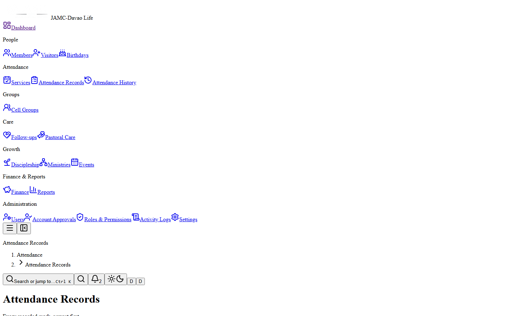

**Figure 22. Attendance records.**

### 13.4 Automatic absentee follow-up

When a member misses a number of **consecutive** sessions (currently **2**; set under **Settings → Attendance**), the system:

1. Creates an **Absentee Follow-up** with **High** priority, due in 3 days, assigned to the member's cell leader.
2. Notifies the people who manage care.

Only attendance types marked **Counts toward absences** in Settings are counted. No second follow-up is created while one is still open for that member.

---

## 14. Cell Groups

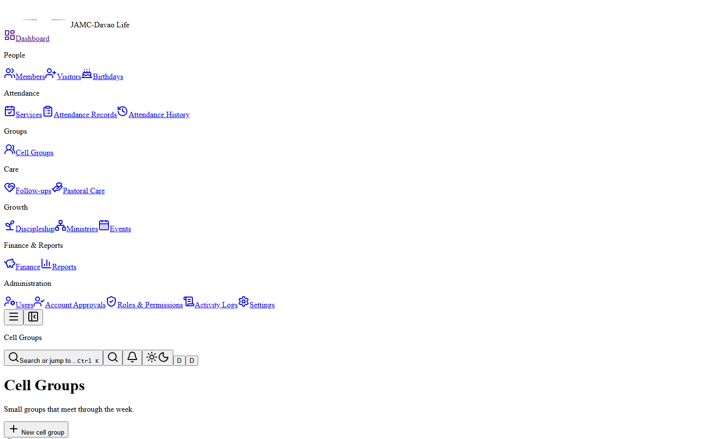

**Figure 23. Cell groups.**

**New cell group** fields: group name, leader, assistant leader, meeting day, meeting time, meeting location, description, active.

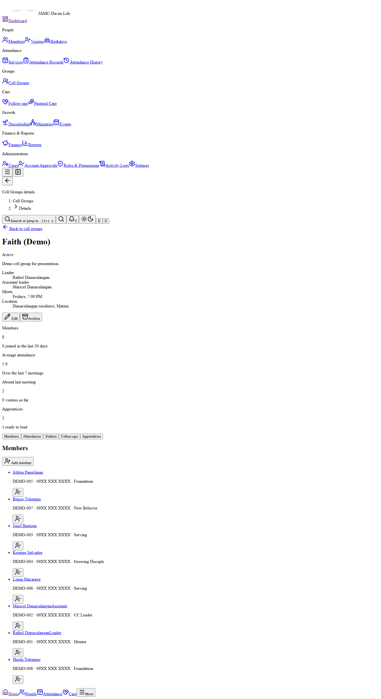

**Figure 24. Cell group details.** Summary figures: Members, Average attendance, Absent last meeting, Apprentices.

| Tab | Contents |
| --- | --- |
| **Members** | Current members; **Add a member** moves a member into this group (their previous group is kept as history) |
| **Attendance** | Meetings recorded for the group |
| **Visitors** | Visitors recorded at the group's meetings |
| **Follow-ups** | Follow-ups for the group's people |
| **Apprentices** | Members being prepared to lead: track (Cell Leader, Ministry Leader, Mentor) and status (In training, Ready to lead, Graduated, Paused) |

Cell leaders see and update only the groups they lead.

---

## 15. Follow-ups

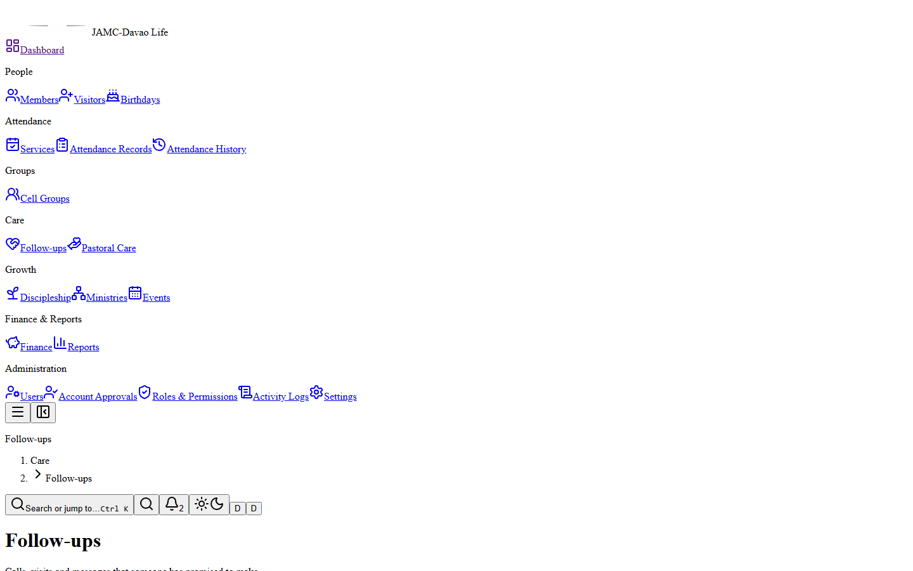

**Figure 25. Follow-ups.**


**Figure 26. New follow-up.**

| Field | Options |
| --- | --- |
| Person | Member or visitor |
| Follow-up type | Call, SMS / Message, Home Visit, Prayer, Encouragement, Pastoral Conversation, Visitor Follow-up, Absentee Follow-up, Other |
| Priority | Low, Normal, High, Urgent |
| Assigned to | A user |
| Due date | Optional |
| Status | Pending, In Progress, Completed, Cancelled |
| Reason, Notes | Free text |

The list marks follow-ups as **Overdue**, **Due today** or due on a date. Select ✓ to mark one **Completed** (the completion date is recorded), or the pencil to edit. The assigned person is notified when a follow-up is assigned and when it is due or overdue.

---

## 16. Pastoral Care

Pastoral care records are confidential.

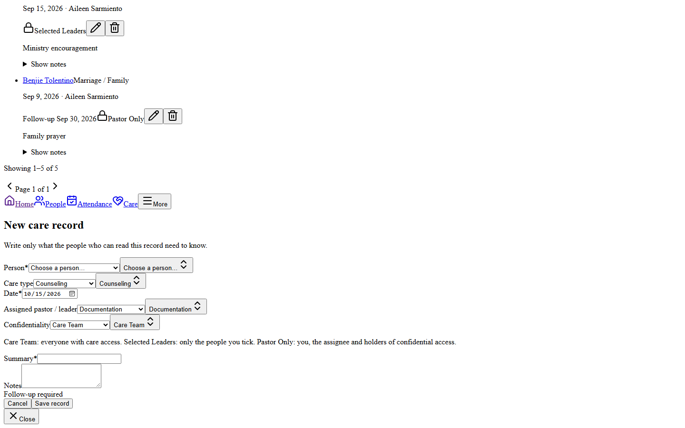

**Figure 27. New care record** (shown empty; no real care notes appear in this manual).

| Field | Notes |
| --- | --- |
| Person, Date | |
| Care type | Counseling, Prayer, Hospital Visit, Home Visit, Bereavement, Marriage / Family, Spiritual Guidance, Encouragement, Other |
| Summary, Notes | |
| Assigned pastor / leader | |
| **Confidentiality** | Who may see the record (below) |
| Share with these leaders | For *Selected Leaders* |
| Follow-up required, Follow-up date | |

**Who can see a care record**

| Confidentiality | Visible to |
| --- | --- |
| **Care Team** | Everyone with permission to view care |
| **Selected Leaders** | The leaders chosen on the record |
| **Pastor Only** | Only people with the *Access confidential pastoral notes* permission |

In every case the **assigned** person and the person who **created** the record can see it. The **Pastoral Care Summary** report shows counts only, never names or notes.

---

## 17. Discipleship

Stages in use: **Visitor → Connected/Bible Study → New Believer → Foundation → Growing Disciple → Serving → Apprentice Leader → CC Leader → Mentor** (editable under Settings → Discipleship).

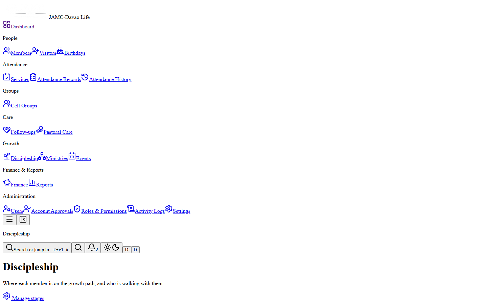

**Figure 28. Discipleship list.** Each member's current stage and mentor.

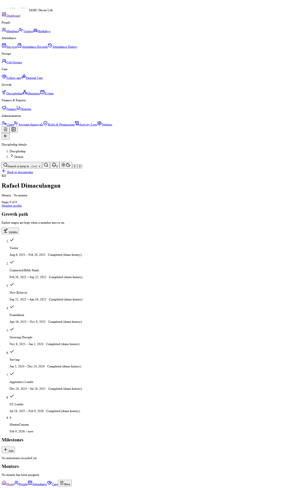

**Figure 29. Discipleship profile.**

- **Growth path** — the stages, with the member's progress along them.
- **Update stage or mentor** — choose the new stage, mentor and a note for this stage. Earlier stages are kept as history; nothing is overwritten.
- **Milestones** — add dated milestones (for example baptism or a completed course).
- **Mentors** — current and past mentors.

The member and their mentor are notified when the member reaches a new stage.

---

## 18. Ministries

Ministries in use: Arrow, Family Life, Praise and Worship, Multimedia Service Team, Ushering, Kids Ministry, Youth, Prayer Team, Administration.

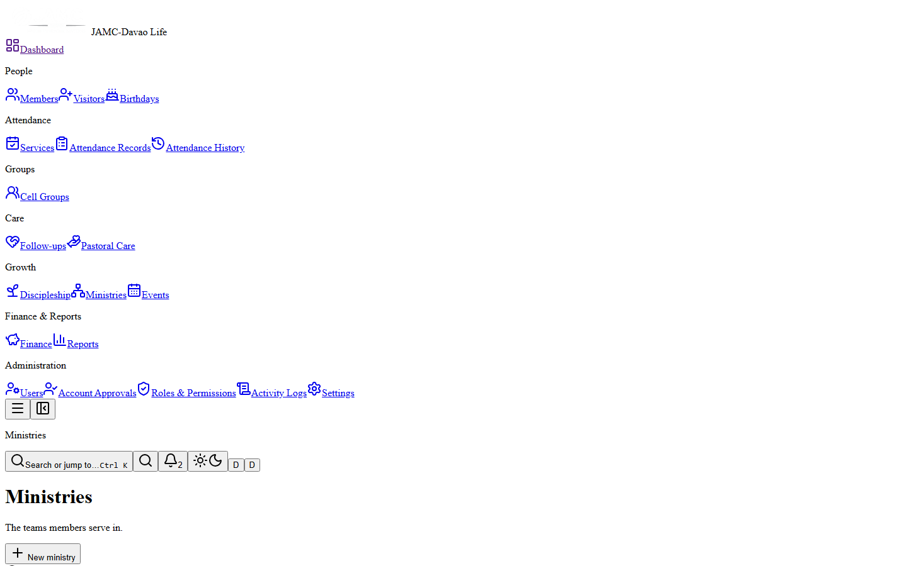

**Figure 30. Ministries.**

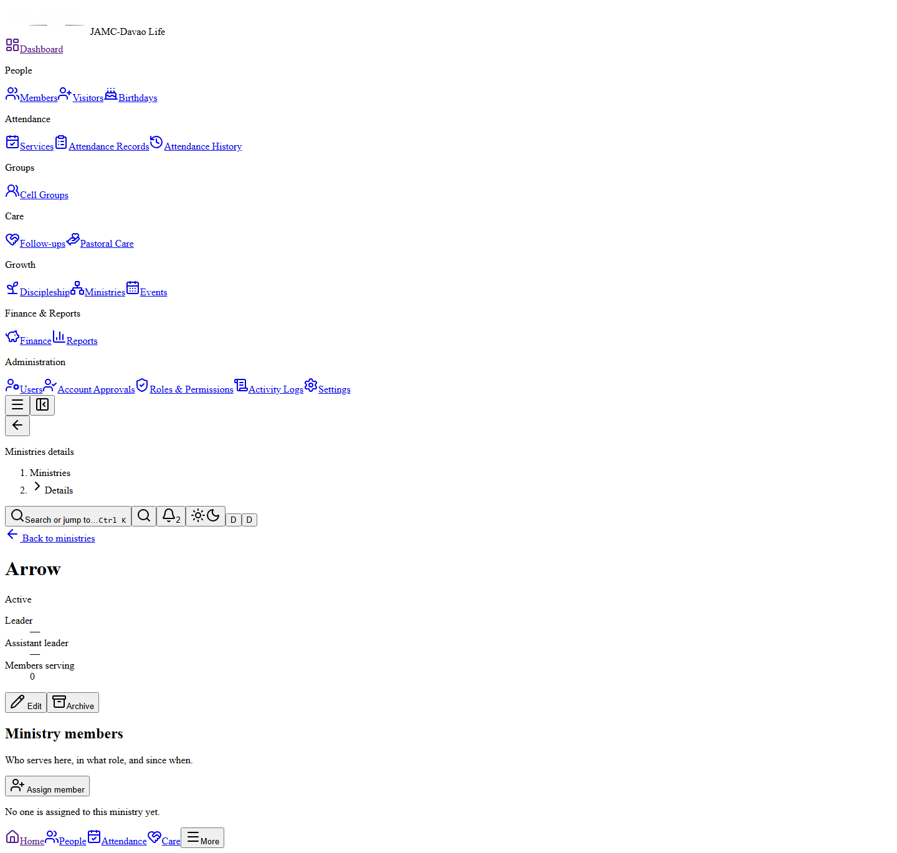

**Figure 31. Ministry details.** Leader, assistant leader and members serving.

**How to assign a member to a ministry:** open the ministry, select **Assign a member**, choose the member, their **Ministry role**, **Date joined** and **Status** (Active or Inactive), then **Assign**. A member can serve in several ministries.

---

## 19. Events

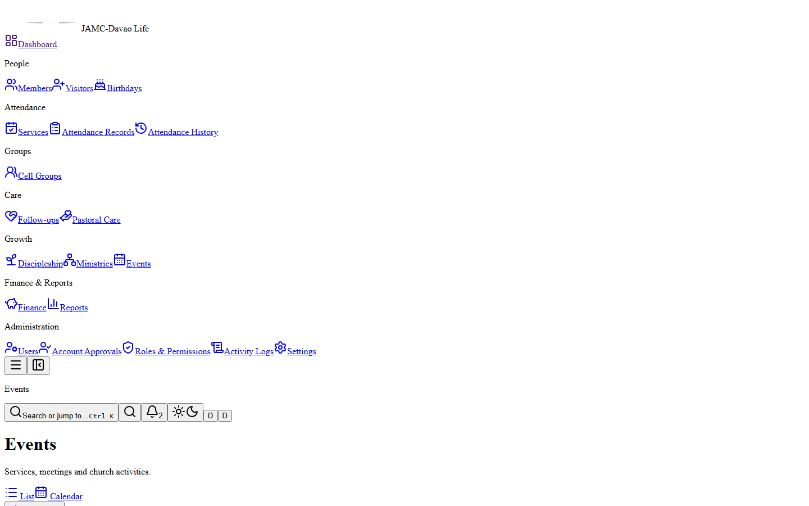

**Figure 32. Events list.**


**Figure 33. Calendar view.**

**Event fields:** event name, event type (Sunday Service, Prayer Meeting, Cell Meeting, Church Event, Outreach, Training, Fellowship, Other), status (Upcoming, Ongoing, Completed, Cancelled), date, start and end time, venue, organizer, description.

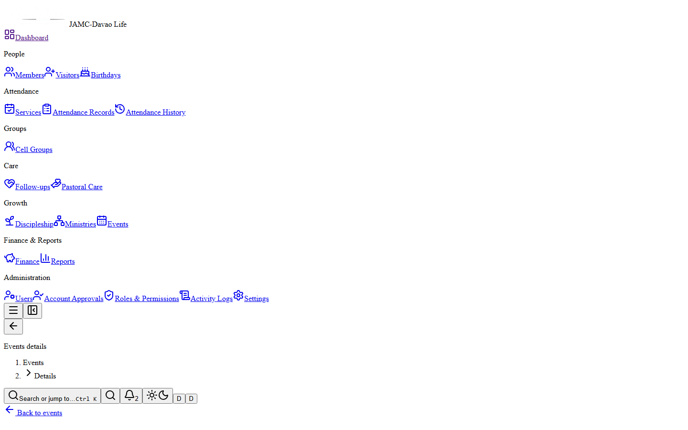

**Figure 34. Event details** with **Event attendance**. An event can be cancelled and reinstated.

---

## 20. Finance

Finance is visible only to people with finance permission.

### 20.1 Category, payment method and account

Every amount has three separate descriptions:

| | Answers | Examples |
| --- | --- | --- |
| **Giving category** | What is it for? | Tithes, Offering, Missions, Building Fund, Special Offering, Other |
| **Payment method** | How was it paid? | Cash, GCash, Maya, Bank Transfer, Check, Other |
| **Financial account** | Where is the money now? | Church Cash, JAMC GCash, the church bank account |

Example: *Tithes · GCash · JAMC GCash · ₱1,000.*

### 20.2 Finance dashboard

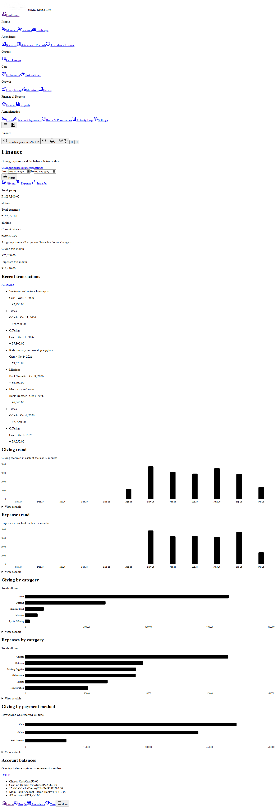

**Figure 35. Finance dashboard.** Total giving, total expenses, current balance, this month's giving and expenses (with a date range), giving and expense trends, giving by category and by payment method, expenses by category, **Account balances** and **Recent transactions**.

### 20.3 Recording one gift (Add giving)

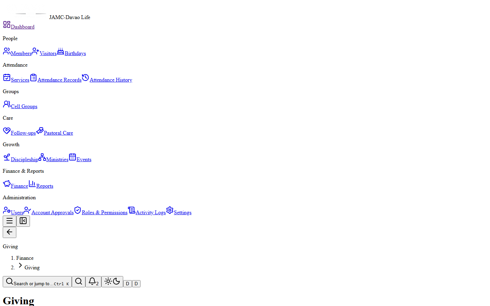

**Figure 36. Giving.** ① Collections ② Add giving ③ New collection.

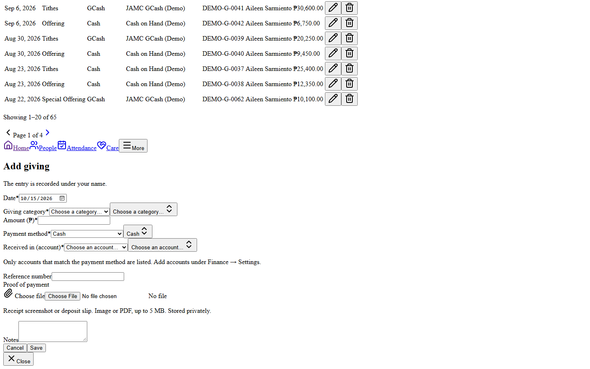

**Figure 37. Add giving.**

1. Open **Finance → Giving** and select **Add giving**.
2. Enter **Date**, **Giving category** and **Amount (₱)**.
3. Choose the **Payment method**; the **Received in (account)** list shows matching accounts.
4. Enter the **Reference number** (required for GCash, Maya and Bank Transfer). For a check, enter the check number, bank and date.
5. If the church tracks individual giving, choose who gave (optional).
6. Attach **Proof of payment** (image or PDF, up to 5 MB; stored privately) and notes if needed.
7. Save.

### 20.4 Recording a whole collection (batch entry)

For a Sunday service, enter all giving on one page instead of one by one.

```
Finance → Giving → New collection → service and date → entry mode → enter giving → Review → Post → reports and balances updated
```

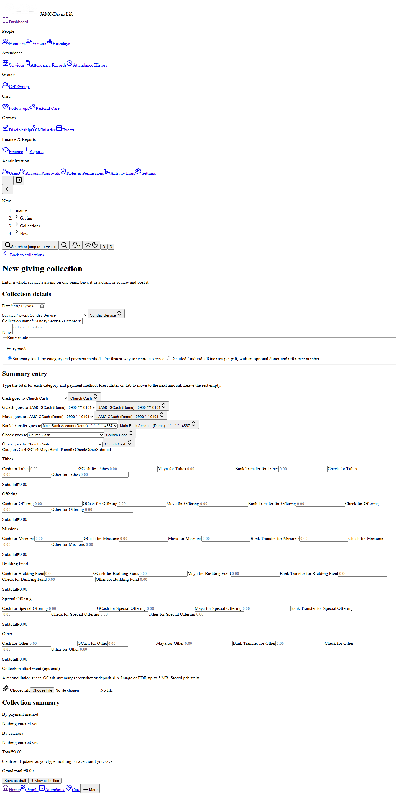

**Figure 38. New collection in Summary mode.**

**How to record a Sunday collection (Summary mode)**

1. Open **Finance → Giving** and select **New collection**.
2. Check the **Date** and **Service / event**; the **Collection name** fills in (e.g. *Sunday Service - October 18, 2026*) and can be changed.
3. Keep **Entry mode: Summary**.
4. Check where each payment method goes (e.g. *Cash goes to Church Cash*).
5. Type the total for each category and payment method, e.g.:

   | | Cash | GCash | Bank Transfer | Subtotal |
   | --- | ---: | ---: | ---: | ---: |
   | Tithes | 15,000 | 4,000 | 2,000 | 21,000 |
   | Offering | 8,500 | 2,500 | 1,000 | 12,000 |
   | **Grand total** | | | | **33,000** |

   **Enter** or **Tab** moves to the next amount. The **Collection summary** updates as you type.
6. Optionally attach a reconciliation sheet, GCash summary or deposit slip.
7. Select **Save as draft** to continue later, or **Review collection**.
8. In the review, compare the totals with the counted money, then select **Confirm & post**.

**Expected result:** the collection is **Posted**. The amounts appear in Giving, the Finance dashboard, account balances and reports.

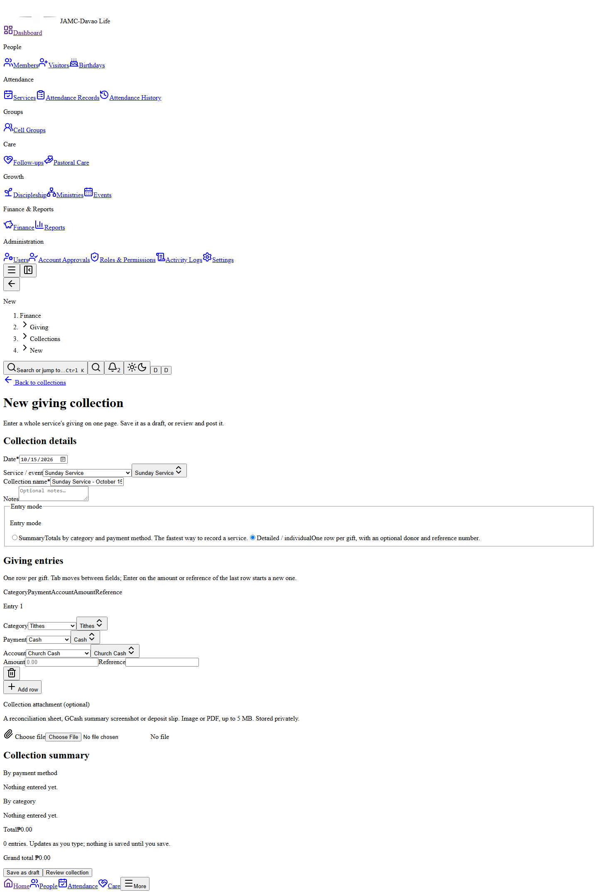

**Figure 39. Detailed / individual mode.** One row per gift: (donor, when individual giving is tracked), category, payment method, account, amount and reference. **Enter** on the last row starts a new row. Leave the donor empty for anonymous giving.

**Collection statuses**

| Status | Meaning |
| --- | --- |
| **Draft** | Being entered. Can be edited or discarded. **Not** in reports or balances. |
| **Posted** | Final. Included in reports and balances. Cannot be edited. |
| **Voided** | Posted by mistake and withdrawn, with a reason. Removed from reports and balances; kept for history. |

> [!IMPORTANT]
> The collection total is only the sum of its entries; it is never counted on top of them. A ₱33,000 collection adds ₱33,000, not ₱66,000. Entries that came from a collection cannot be edited one by one; void the collection and enter it again.

The review warns about **possible duplicate** reference numbers already recorded, so the same GCash or bank transaction is not entered twice.

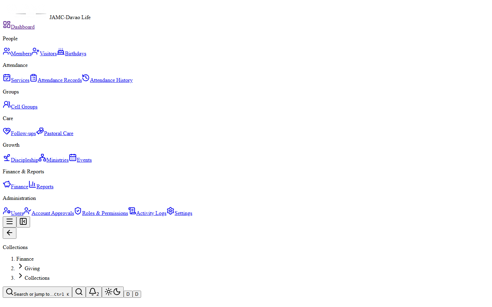

**Figure 40. Collections list.** Open a posted collection to see the payment and category breakdown and every entry; **Void collection** is there for corrections.

### 20.5 Expenses

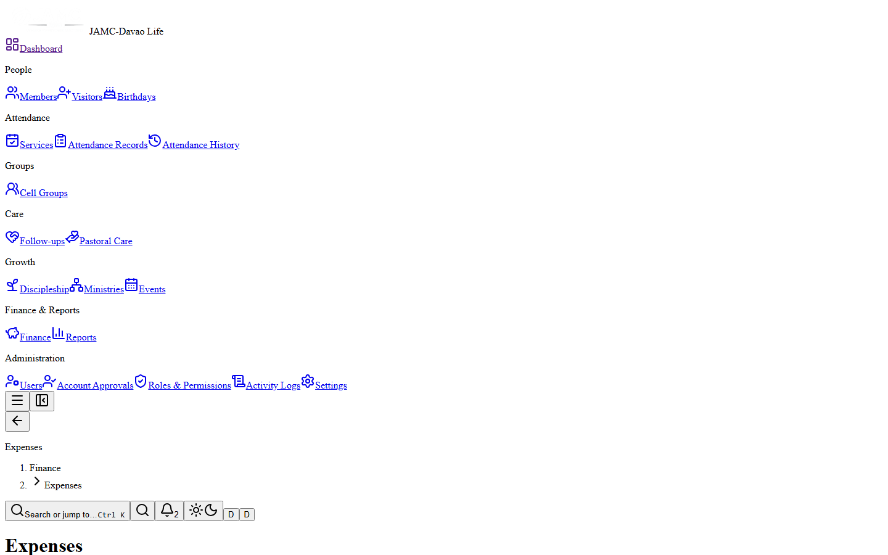

**Figure 41. Expenses.** Add expense: date, expense category, description, amount, payee, payment method, **Paid from (account)**, reference number, notes.

### 20.6 Transfers between accounts


**Figure 42. Transfers.** Record money moved between church accounts (e.g. GCash → bank deposit): from, to, amount, date, reference, notes.

> [!IMPORTANT]
> A transfer is **not** new income. If ₱5,000 was given through GCash and then moved to the bank, total giving is still ₱5,000: the GCash balance goes down and the bank balance goes up.

### 20.7 Finance settings

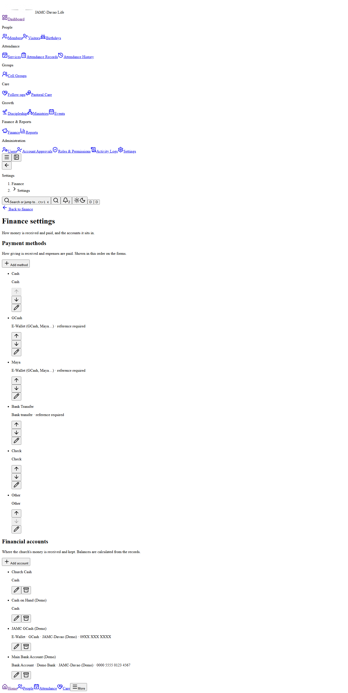

**Figure 43. Finance settings.**

- **Payment methods** — name, *Works like* (cash, e-wallet, bank, check, other), *Reference number is required*, active.
- **Financial accounts** — account name, type, provider or bank, account holder, account number, opening balance, notes, active. Account numbers are shown **masked** (e.g. `**** **** 5678`) to everyone except finance managers.

Giving and expense categories, and whether individual giving is tracked, are under **Settings → Finance**.

---

## 21. Reports

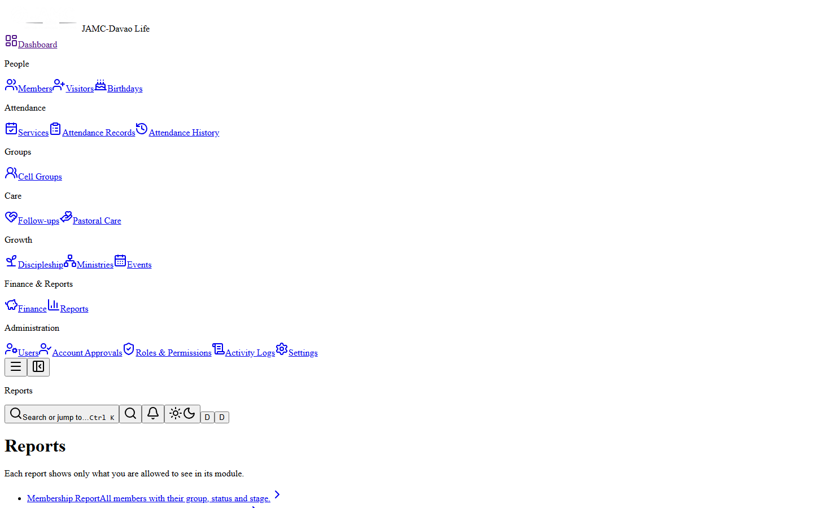

**Figure 44. Reports.** Only the reports your role allows are listed.

| Report | Contents |
| --- | --- |
| Membership Report | All members with their group, status and stage |
| Visitor Report | Visitors by first visit date and follow-up status |
| Attendance Report | Present and absent counts per service or meeting |
| Cell Group Report | Membership and attendance of every cell group |
| Follow-up Report | Follow-ups by status, priority and due date |
| Pastoral Care Summary | How much care was given, by type (counts only) |
| Discipleship Report | Each member's stage and mentor |
| Ministry Report | Who serves in which ministry, and in what role |
| Event Report | Events with their status and attendance |
| Church Growth Report | New members, total members and new visitors per month |
| Finance Report | Giving and expenses in one ledger, with totals |
| Account Transaction Report | Per account: opening balance, giving, expenses, transfers and balance |


**Figure 45. A report.** Use the filters, then:

- **Print / Save as PDF** — opens the print window; choose *Save as PDF* to keep a file.
- **Export CSV (Excel)** — downloads the report as a file that opens in Excel (needs the *Export reports* permission).

---

## 22. Administration

### 22.1 Users

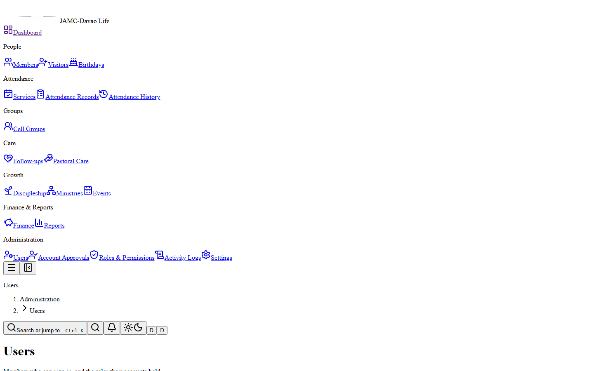

**Figure 46. Users.** Each account shows the linked member (link to the profile), login email, roles, status and last login. Row buttons: link to a member (for accounts without one), change roles, send password reset, suspend or reactivate. See [Add User](#112-add-user-administration).

### 22.2 Roles & Permissions

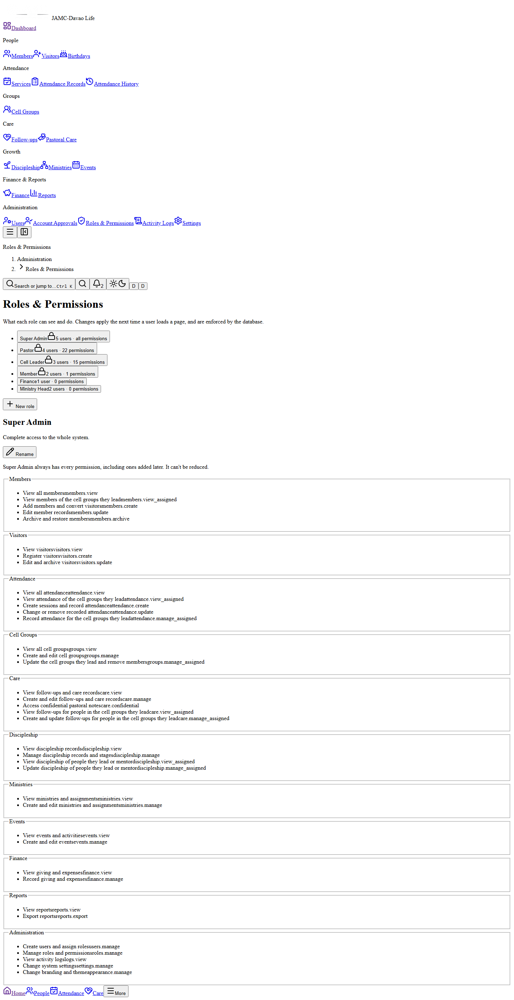

**Figure 47. Roles & Permissions.** Create roles and tick the permissions each one has, grouped by module. Changes apply immediately to everyone with that role.

### 22.3 Activity Logs

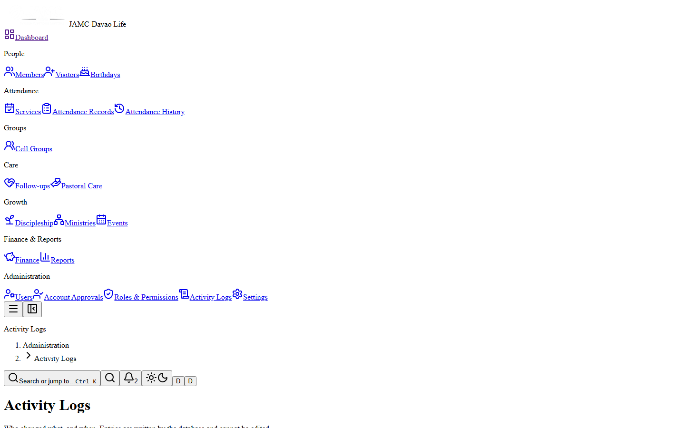

**Figure 48. Activity Logs.** Who did what and when: records created, updated, archived or deleted; accounts approved, rejected or linked; collections posted or voided; settings changed. Finance amounts and confidential care notes are not written into the log.

---

## 23. Settings

**Administration → Settings** has these tabs (each appears only for the right permission):

| Tab | Contents |
| --- | --- |
| **General** | Church name, address, contact number, email, timezone, date format, **Rows per page** for every list |
| **Branding & Appearance** | Everything in [23.1](#231-branding--appearance) |
| **Membership** | Member ID prefix and number of digits; membership and baptism status lists |
| **Attendance** | Consecutive absences before a follow-up; attendance types (and whether each counts toward absences); attendance statuses (and whether each counts as present) |
| **Discipleship** | Discipleship stages |
| **Ministries** | Ministry list |
| **Finance** | Track individual giving; giving and expense categories |
| **System** | Remove demo data (Super Admin, when demo data exists) |


**Figure 49. General settings.**

### 23.1 Branding & Appearance

All changes are previewed immediately and saved only with **Save changes**. Each section has its own **Reset to default** with confirmation.


**Figure 50. Branding.** System name, short name, tagline; church logo (with size and background remover), login logos for light and dark mode, favicon, login background.

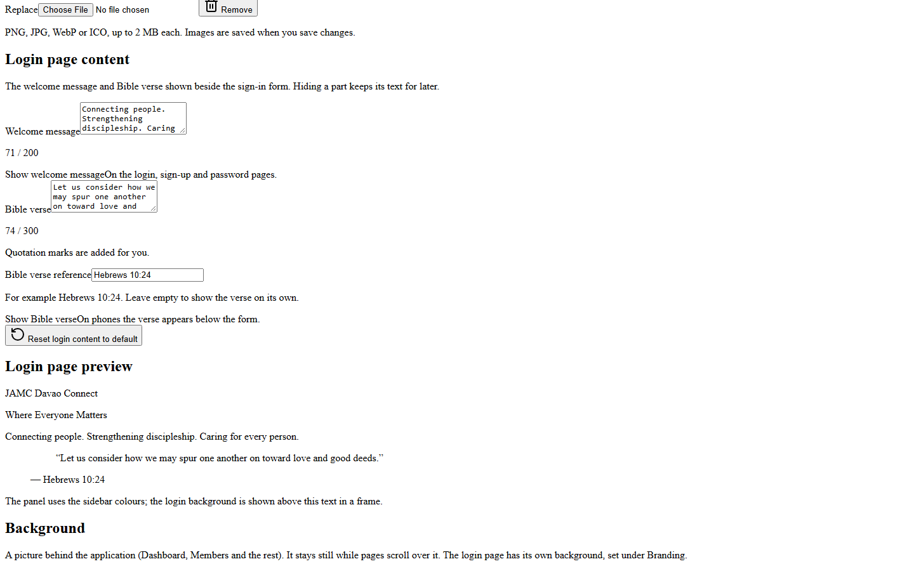

**Figure 51. Login page content.** Welcome message (up to 200 characters), Bible verse (up to 300), verse reference, and switches to show or hide each.

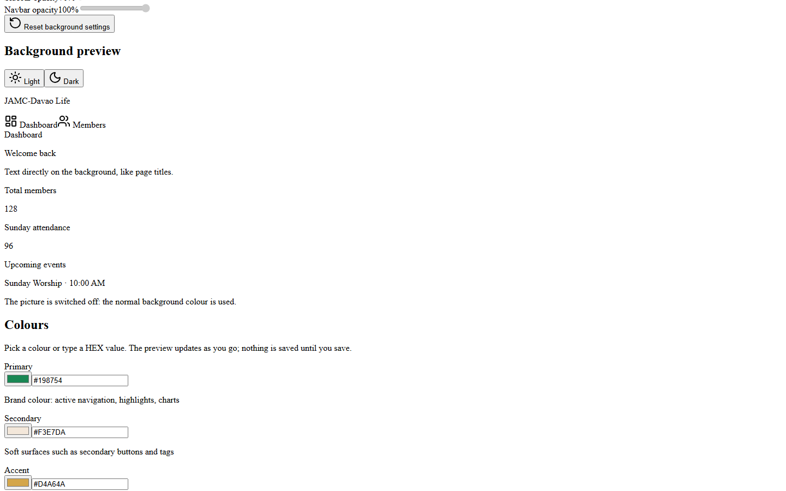

**Figure 52. Background.** A picture fixed behind the whole system: the pages scroll over it and it does not move. Size, position, overlay colour and opacity (separately for light and dark mode), blur, brightness, card style (solid or slightly transparent), sidebar and navbar opacity. Large photos are resized and compressed automatically.

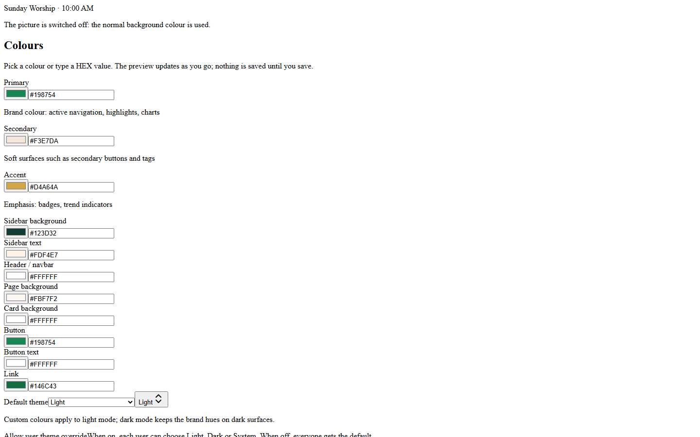

**Figure 53. Colours and theme.** Primary, secondary, accent, sidebar, header, page background, cards, buttons and links; default theme (Light, Dark, System) and whether users may choose their own.

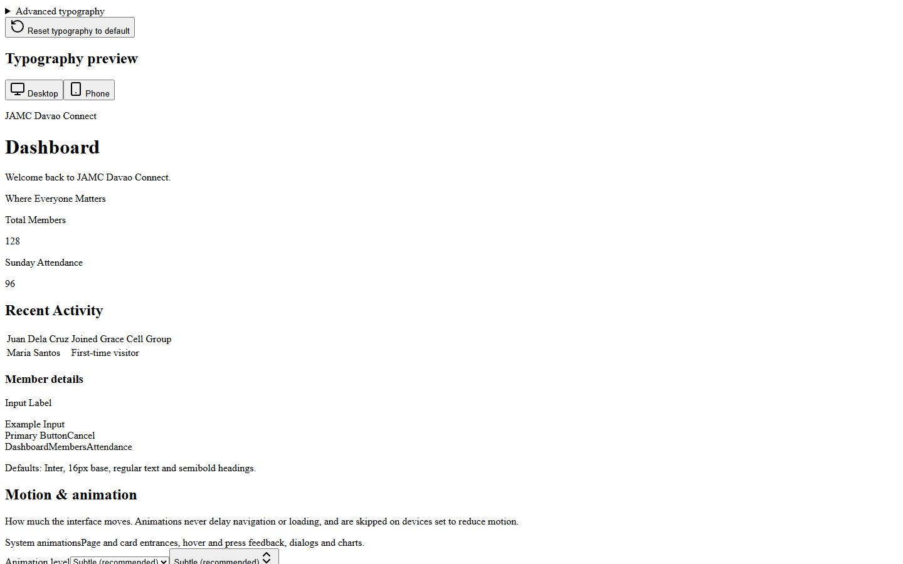

**Figure 54. Typography.** Primary and heading fonts, weights, base font size (14–20 px), heading scale, mobile font scale, and sizes for buttons, inputs, tables and the sidebar (more under *Advanced typography*).

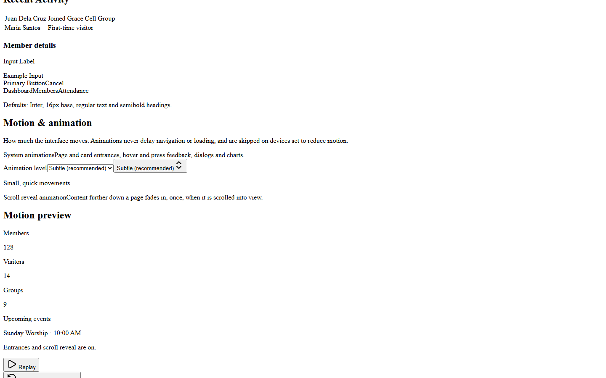

**Figure 55. Motion & animation.** System animations on or off, animation level (Off, Subtle, Normal) and scroll reveal. Devices set to reduce motion are always respected.

---

## 24. Mobile Guide

On a phone the system uses the same data and permissions, arranged for a small screen.

| | |
| --- | --- |
| 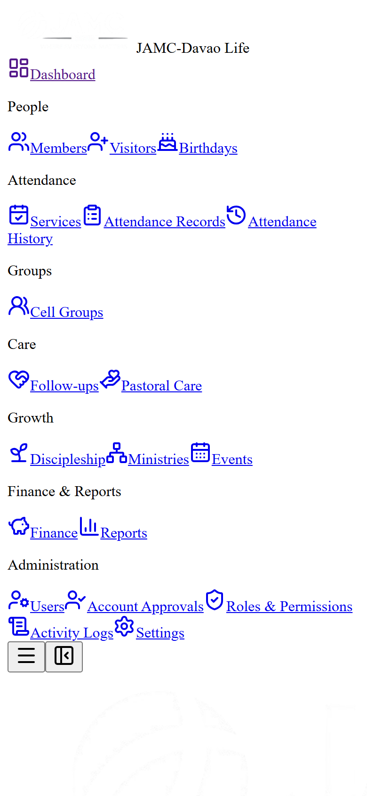 | 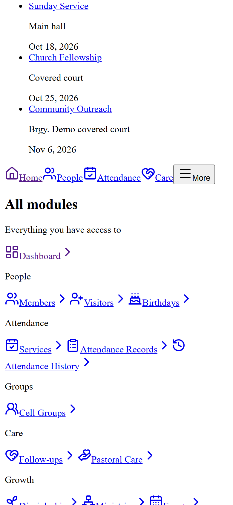 |
| **Figure 56. Home.** Header with the church logo; tabs at the bottom. | **Figure 57. More.** Every module you can open. |

- **Bottom tabs:** Home, People, Attendance, Care and **More**.
- **Back arrow** at the top left on inner pages.
- **Avatar** at the top right: profile, password, theme, log out.
- **Lists become cards**; tap a card to open it.
- **Forms and selections open as sheets from the bottom**, with a search box.

| | |
| --- | --- |
| 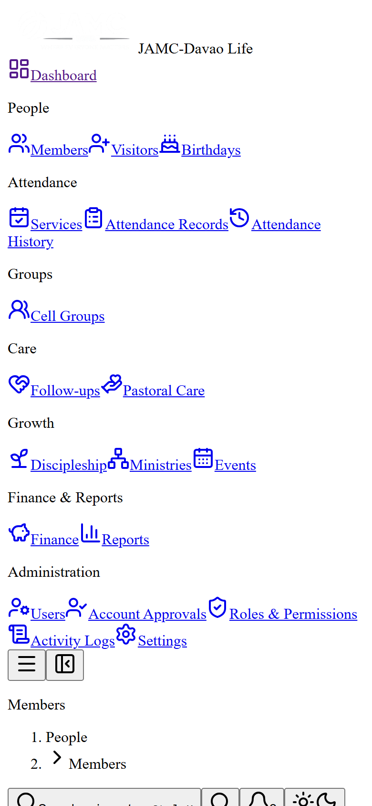 |  |
| **Figure 58. Members.** | **Figure 59. Member profile.** |
| 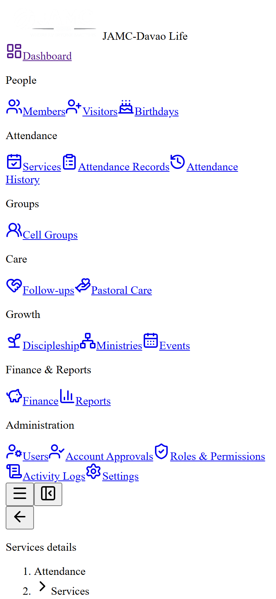 | 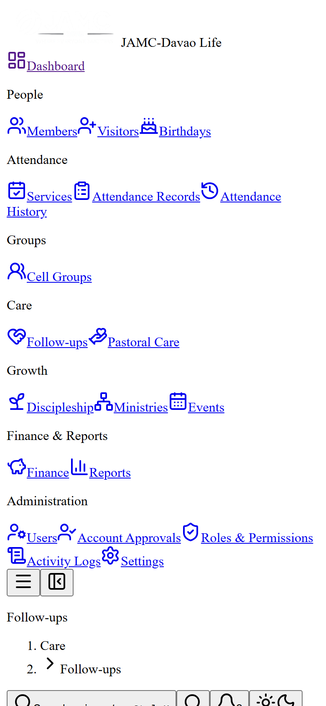 |
| **Figure 60. Recording attendance.** | **Figure 61. Follow-ups.** |
| 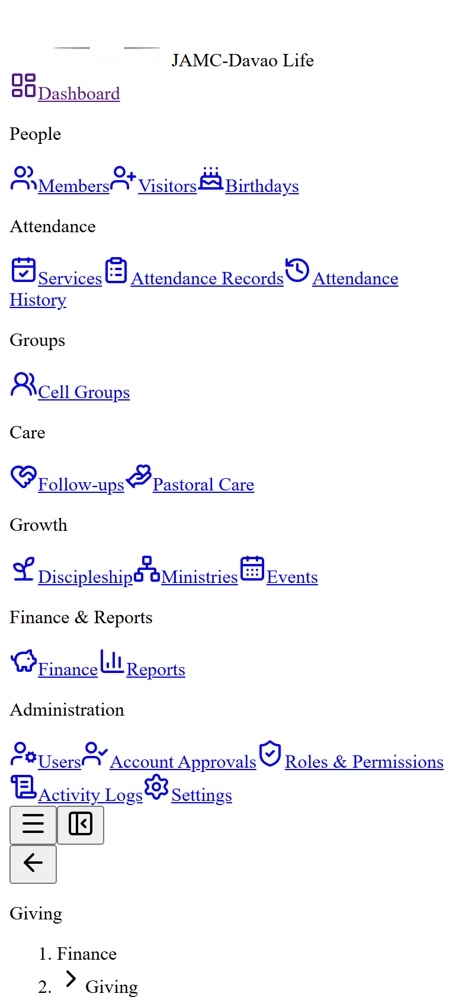 |  |
| **Figure 62. Giving.** | **Figure 63. New collection (summary).** |
|  |  |
| **Figure 64. A selection opens as a searchable sheet.** | **Figure 65. Login.** |

> [!TIP]
> The system can be added to the phone's home screen from the browser menu (*Add to Home screen*); it then opens like an app.

---

## 25. Common Workflows at a Glance

**New member**
```
Add Member → Save → (optional) Create user account → Choose role → Send invitation
```

**New visitor**
```
Register visitor → Follow-up → Returning visitor → Connect to a cell group → Convert to member
```

**Self-registration**
```
Sign up → Confirm email → Pending approval → Admin: Review → link member + role → Approve
```

**Sunday attendance**
```
Attendance → Services → open or add session → mark everyone → Save → statistics updated → absences checked
```

**Sunday giving**
```
Finance → Giving → New collection → Summary mode → enter Cash / GCash / Bank totals → Review → Post → Finance updated
```

**GCash deposited to the bank**
```
Finance → Transfers → GCash account → bank account → amount → Save (giving total unchanged)
```

---

## 26. Troubleshooting

| Problem | What to do |
| --- | --- |
| **Cannot sign in** | Check the email and password; use **Forgot password?**. A suspended or disabled account cannot sign in: ask an administrator. |
| **"Pending approval" after signing in** | An administrator has not approved the registration yet. |
| **"That link is invalid or has expired"** | Request a new email (password reset or invitation). Links expire. |
| **"Your email address is confirmed. Sign in to continue."** | The confirmation link was opened on another device. The email is confirmed; just sign in. |
| **A menu item is missing** | Your role does not include it. Ask a Super Admin. |
| **Cannot see Finance** | Finance needs the finance permission. |
| **Cannot see a pastoral care record** | Its confidentiality limits who may see it. |
| **Member not in the Add User list** | Add the person as a member first; archived members are not listed. |
| **"Already has a system account"** | That member already has a login; manage it from Account access. |
| **A collection is not in the reports** | Only **Posted** collections count. Open it and post it. |
| **Cannot edit a giving entry** | It came from a posted collection. Void the collection and enter it again. |
| **Upload failed** | Check the file type and size (photos 2 MB, receipts 5 MB). |
| **"You don't have permission to do that"** | Your role does not allow the action. |
| **The page shows an error** | Select **Try again**; check the internet connection. |

---

## 27. Security Notes

- **Everyone sees only what their role allows.** This is enforced by the database itself, not just by hiding buttons.
- **New registrations cannot see anything** until an administrator approves them.
- **Pastoral care is confidential.** Choose the right confidentiality on every record.
- **Finance is restricted** to finance users. Receipts are stored privately and opened through short-lived links. Account numbers are masked for everyone except finance managers.
- **Do not share passwords.** Each person should have their own account.
- **Disable accounts that should no longer have access** (Suspend Account). This keeps their member history.
- **Only a Super Admin can give Super Admin, finance or administration access.**
- **Changes are recorded** in the Activity Logs.

---

## 28. Glossary

| Term | Meaning |
| --- | --- |
| **Member** | A person in the church records. |
| **Visitor** | Someone who visited but is not yet a member; can be converted to a member. |
| **User account** | A login (email and password) for one member. |
| **Role** | A named set of permissions given to an account. |
| **Permission** | Permission for one kind of action, such as "View all members". |
| **Account approval** | An administrator's decision to let a self-registered person sign in. |
| **Cell group** | A small group with a leader, meeting regularly. |
| **Apprentice** | A member being prepared to lead. |
| **Session** | One service, meeting or event on one date, for attendance. |
| **Follow-up** | A task to contact or care for someone. |
| **Pastoral care record** | A confidential record of care given. |
| **Confidentiality** | Who may see a care record: Care Team, Selected Leaders, Pastor Only. |
| **Discipleship stage** | A step on the church's growth path. |
| **Giving category** | What a gift is for (Tithes, Offering, …). |
| **Payment method** | How it was paid (Cash, GCash, …). |
| **Financial account** | Where the money is (Church Cash, GCash, bank). |
| **Giving collection** | A batch of giving entered together for one service or event. |
| **Draft / Posted / Voided** | A collection being entered / final and counted / withdrawn but kept. |
| **Internal transfer** | Money moved between church accounts; not income. |
| **Archive** | Hide a record from lists while keeping its history; can be restored. |
